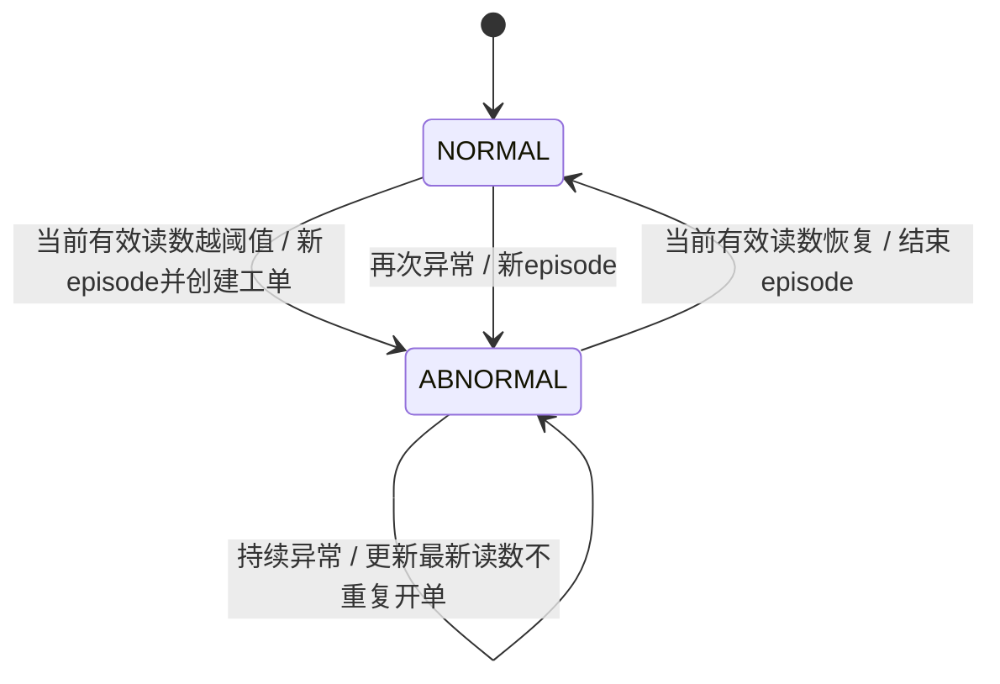
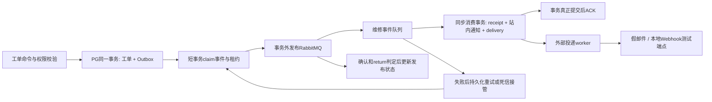

# Atlas CMMS：面向 Java 实习与校招的技术增强规划 V2

> **代码实现补记（2026-11-14）**：用户随后明确授权“所有代码”，本轮已实现核心增强并完成选定组合回归。当前实现、测试结果、启动方式与未完成范围见 [实现与验证交接](maintenance-enhancement-implementation.md)。下文“仅规划/未实现”等表述保留为当时的历史记录；S/E 源码行号对应原基线，不是修改后的行号。

更新日期：2026-11-14（Asia/Shanghai）。工作目录：`E:\intern projects\cmms-fork`。规划基线：`6f2bad34ffb13b42b05f6319953c2395cd0565f1`；业务源码基线：官方 `06abfe35d09372ff80f889fcde73eb3cc71dc205`。

本文件更新原报告的**技术选型、实施顺序和个人能力目标**，不推翻已核实的调用链、缺陷证据或测试边界。原证据见 [后端审计报告](java-backend-enhancement-audit.md)，既有验证见 [Git 恢复验证](audit-evidence/git-recovery-verification.md)。文中 S01–S61 沿用原报告源码索引；本轮新增 E 索引在文末，均有实际文件和行号。

## 0. 最终定位与不可越过的边界

**项目定位：设备维护业务中的可靠工单与维修数据平台增强。** 业务闭环是：

> 仪表异常周期识别 → 幂等生成维修工单 → 授权领用备件 → 可靠维修通知 → 设备工单效率分析。

通用技术必须服务于这个闭环。明确必做：**Redis 共享缓存、RabbitMQ 可靠消息、PostgreSQL 事务与并发控制、权限回归及自动化测试**。MyBatis-Plus 推荐在一个新增只读设备维修台账中实践；MySQL 必学，但使用独立实验库，不迁移 CMMS 主库。

保留 Java 17、Spring Boot 3、JPA、PostgreSQL、Liquibase、Quartz、原有工单流程、前端和许可证检查。不给项目添加秒杀、抢购、商城、短链接，不为技术覆盖拆微服务或分库分表。原有定期保养继续由现有机制生成工单；本轮规划增强其幂等与通知衔接，不重写为通用规则平台。

这次取舍变化来自你的明确学习目标：即使目前单机规模可以用 Caffeine 和数据库轮询实现部分能力，仍把 Redis、RabbitMQ 作为**有边界、可对照实验的必做训练**。这不表示已经证明当前业务存在高并发或中间件是唯一解。

### 0.1 每项新增技术必须通过的五个问题

| 技术/增强 | CMMS 的具体问题、原实现局限 | 相对简单方案的选择理由 | 区别于常见商城项目的亮点 | 个人必须提供的证据 |
|---|---|---|---|---|
| Redis 设备工单概览缓存 | 现有设备统计有重复取数，Caffeine 仅进程内，缓存命中可跳过方法体授权；未测得真实瓶颈 [S25–S28][E01–E04] | 保留本地缓存其他用途；在两实例查询模块比较无缓存/Caffeine/Redis，练习共享缓存和失效；不宣称 Redis 必然更快 | 同设备、同维修统计口径的缓存，权限撤回、工单移设备、旧读回填可验证 | 固定维修数据集、两实例读写时序、撤权测试、p95/p99 与 SQL 数量原值 |
| RabbitMQ + Outbox | 现有通知/邮件/Webhook 有异步线程，缺持久化投递接管和重试账本 [S22–S24] | 数据库轮询是教学中间步骤；最终接 MQ 练习 broker 确认、ACK、故障恢复，保留 DB 原子性 | “维修已派单但通知未送达”可追踪、补投；邮件不冒充绝对一次送达 | 数据库提交/发送/确认/ACK 各崩溃窗口的恢复记录 |
| 仪表状态机、数据库锁/唯一键 | 连续异常和编辑读数会再次触发；`recurrent/waitBefore` 未形成可靠闭环 [S03–S05] | 数据库管业务不变量；比单进程锁适用多实例，比 Redis 锁更直接地与创建工单事务耦合 | 正常、异常持续、恢复、再次异常是设备生命周期问题，不是抢库存模型 | 同异常周期一张工单、恢复后新周期、乱序与历史编辑测试 |
| 库存事务与命令幂等 | 领用权限检查顺序、扣库/明细/流水事务边界待增强；已有 Part 乐观锁 [S17–S21] | 先修事务边界，复用乐观锁；竞争明显再评估悲观锁/条件更新 | 维修领用、退料、采购补库和审计流水闭合 | 并发领用、失败回滚、重复命令、无权限零副作用 |
| MyBatis-Plus 只读维修台账 | 已有 JPA 查询与预聚合 SQL，但缺本次定义的多条件工单效率台账 [S12][S54] | 为显式 SQL、分页和 MP 实践开小边界；JPA projection 仍是基线，不整体替换 | 设备/优先级/维修状态/异常来源维度，时间口径可解释 | 手算数据集、权限对照、count 正确性、EXPLAIN、与 JPA 等价测试 |
| MySQL 独立实验 | 生产主库是 PG，不能借项目名声称掌握 InnoDB | 少量同构维修表做双数据库实验；不增加生产双写 | 比较同一领用/维修查询在 PG 与 MySQL 的锁、索引、方言 | 两连接实验脚本、执行计划、异常和回滚记录，标为实验贡献 |

### 0.2 事实与验收目标分开

- **已有实测**：Git 恢复时编译 773 个生产源文件、93 个测试源文件；选定 10 个测试类实际 474 个 testcase 通过；4 个 Mockito/纯 Java 探针复现原行为。不是全套集成测试通过。
- **本轮操作**：读取源码、核对参考项目和官方文档、更新规划；没有运行新的业务测试、压测、数据库操作，没有引入依赖或修改业务代码。
- **本轮所有新表、新类、队列、Redis key、指标和耗时目标均为设计提案**，并非已经实现。下文没有填写未经测量的性能提升比例。
- 原 T01、T06 库存事务、T08 安全权限、T12 测试基线持续有效。P0 验证失败必须先处理，再推进中间件。

## 1. 与国内常见项目对标：学能力，不移植业务

这是选定代码样本的对照，不是国内招聘岗位占比统计，也不是对所有课程版本的穷尽调查。版本、分支不同会改变技术栈；尤其不能把黑马点评衍生版的 Kafka 或 Shortlink 的 Redis Stream 说成所有项目都用了 RabbitMQ。

| 项目样本 | 本次实际核查 | 能力参考 | 不搬入 CMMS 的部分 | CMMS 对应实践 |
|---|---|---|---|---|
| 黑马点评：本机 `hmdp-plus-master` 衍生版 | POM Java17/Boot3、MP/Redisson；`SeckillVoucherOperate` 调用 Lua，`SeckillVoucherProducer` 使用 KafkaTemplate；不是原课程唯一官方版本 | 热点缓存、Lua 原子性、锁、幂等、缓存失效 | 优惠券抢购、秒杀令牌、为了流量而造活动 | 设备热点查询、缓存重建抑制、异常周期/领用命令去重 |
| 苍穹外卖：本机课程源码副本 | `sky-server` POM 有 MyBatis/MySQL/Redis；用户 `SetmealController` 使用 Cacheable；`OrderTask` 有 Scheduled | Controller/Service/Mapper 分层、Redis、SQL、定时任务、WebSocket | 菜品、购物车、支付与抢单 | 维修查询 API、备件事务、站内维修提醒、定期保养 |
| `macrozheng/mall` | 提交 `dcaa93b3`；RabbitMqConfig 配置延迟订单队列/DLX；CancelOrderReceiver 是真实 RabbitListener | RabbitMQ 路由、超时业务、缓存和 MyBatis 工程分层 | 商城订单/支付；不可把 mall-swarm 的微服务栈归给所有 mall 模块 | 维修事件投递、失败队列、故障重放；补充 Outbox 与幂等证据 |
| `nageoffer/12306` | 提交 `daf3a271`；TicketAvailabilityTokenBucket 有 Redisson/Lua，PayResultCallbackOrderConsumer 使用 RocketMQListener | 原子操作、并发边界、幂等、多服务交易复杂度 | 抢票、分布式购票事务和分片规模 | 异常工单唯一性、备件一致性；比较 MQ 语义但主线只接 RabbitMQ |
| `nageoffer/shortlink` | 提交 `02da2983`；ShortLinkServiceImpl 有 MP、Redis、Bloom、锁；RedisStreamConfiguration 配置消费组 | Cache Aside、穿透保护、统计异步、消息重复处理 | 跳转、短码生成与无证据的海量分片 | 设备概览缓存、维修效率统计，理解消费组而非再装一套 Stream |
| Atlas CMMS 当前 | Java17/Boot3/JPA/PG，Caffeine、Bucket4j、Quartz、异步通知、权限、测试已存在 | 有真实设备维修领域，已有功能可跑、可追踪 | 不把上游既有能力计为个人实现 | 补强“异常周期、领用事务、可靠通知、统计与共享缓存”闭环 |

远程样本已检查 POM、Git tree 和具体类；没有构建它们，也不据此断言其全部实现可靠。源码链接：

- [mall RabbitMqConfig](https://github.com/macrozheng/mall/blob/dcaa93b3150352e5044708d7211b5bed0af4509f/mall-portal/src/main/java/com/macro/mall/portal/config/RabbitMqConfig.java#L41)、[CancelOrderReceiver](https://github.com/macrozheng/mall/blob/dcaa93b3150352e5044708d7211b5bed0af4509f/mall-portal/src/main/java/com/macro/mall/portal/component/CancelOrderReceiver.java#L16)。
- [12306 令牌桶实现](https://github.com/nageoffer/12306/blob/daf3a2714c00ff263764d23ab10c2eaed2ae842d/services/ticket-service/src/main/java/org/opengoofy/index12306/biz/ticketservice/service/handler/ticket/tokenbucket/TicketAvailabilityTokenBucket.java#L90)、[支付结果消费类](https://github.com/nageoffer/12306/blob/daf3a2714c00ff263764d23ab10c2eaed2ae842d/services/order-service/src/main/java/org/opengoofy/index12306/biz/orderservice/mq/consumer/PayResultCallbackOrderConsumer.java#L44)。
- [Shortlink 缓存与锁](https://github.com/nageoffer/shortlink/blob/02da2983c9211928cb473bbbaac67b93f925c138/project/src/main/java/com/nageoffer/shortlink/project/service/impl/ShortLinkServiceImpl.java#L383)、[Redis Stream 配置](https://github.com/nageoffer/shortlink/blob/02da2983c9211928cb473bbbaac67b93f925c138/project/src/main/java/com/nageoffer/shortlink/project/config/RedisStreamConfiguration.java#L72)。

本地课程副本证据路径与行号列于附录，不给它们虚构 Git SHA 或官方身份。项目比较用于选择训练内容，不以框架数量给项目打分。

## 2. 完整 Java 校招技术矩阵

现状：**已有**表示找到实际调用；**初步**表示存在但缺边界/验证；**未找到**限于本轮主源码、POM、配置与原审计范围，非全生态断言。岗位层次用“核心/加分/了解”；项目决策用“必做/推荐/可选”，两者不同。例如 MySQL 是核心知识，却不应替换 CMMS 的 PG。

难度 1–5 针对当前基础。任务代号：B=基线与权限，C=事务并发，R=Redis，M=可靠消息，Q=MP/SQL 查询，L=独立技术实验。下表任务对应后文完整文件、依赖、表结构与步骤。

### 2.1 Java、Spring、安全与异步

| 技术 | CMMS 现状与代码位置 | 岗位/项目决策 | 落点、难度 | 验证与面试问题 |
|---|---|---|---|---|
| Java17、集合、Stream | 已有；POM，ReadingService 遍历触发器、NotificationService 去重/过滤 [S01][S03][S22] | 核心/必学 | C/M，2 | 写状态机与收件人去重测试；HashMap/ConcurrentHashMap、可变对象线程安全有何区别？ |
| IOC、构造注入 | 已有；RequiredArgsConstructor、Service/Repository 组合 [S06][S22] | 核心/必学 | B/C，2 | 自己搭一个命令 Service 的依赖图；循环依赖和 Lazy 不是事务边界 |
| AOP、代理、异常处理 | 已有；TenantAspect、RestExceptionHandler [S35][S52] | 核心/必增强 | B/C，3 | 验证内部调用不经过代理、异常转换409；为什么注解不保证执行？ |
| Spring 事务传播、回滚 | 初步；Service 有事务，跨 Service/Controller 命令缺总边界 [S17–S21][S32] | 核心/必做 | C/M，4 | 数据库断言回滚，REQUIRED/REQUIRES_NEW、rollback-only、自调用如何影响？ |
| Spring Security、JWT | 已有；WebSecurityConfig、JwtTokenProvider、RefreshTokenService [S31–S33][E05] | 核心/保留并增强 | B，3 | 禁用/撤权/refresh 并发；JWT签名正确是否等于当前仍有权限？ |
| RBAC、企业隔离、数据权限 | 初步；实体 PostLoad、请求体AOP、canBeViewedBy、Helper.resolveCompanyId [S34–S36][E03] | 核心/必做 | B/R/Q/M，4 | 两企业多角色矩阵；缓存、MyBatis、后台消费者为什么必须补显式范围？ |
| 线程池、@Async | 已有；3线程、队列11、SecurityContext包装，通知/邮件/Webhook使用 [S22–S24] | 核心/增强已有 | M，3 | 队列满、超时、拒绝策略、优雅停机；线程池为何不等于持久消息队列？ |
| CompletableFuture | 已有有限使用；NotificationService 等待 Expo SDK futures [E06] | 核心基础/不强增链路 | L，2–3 | 用假慢任务练allOf、get/join、超时、异常传播、指定executor；不能算自己实现了SDK并发 |

### 2.2 数据库与持久层

| 技术 | CMMS 现状与代码位置 | 岗位/项目决策 | 落点、难度 | 验证与面试问题 |
|---|---|---|---|---|
| PostgreSQL/JPA/Hibernate | 已有；Repository、实体、PG配置 [S01][S02][S12] | 核心/保留 | C/Q，3 | 懒加载、脏检查、flush时机、N+1、投影；save何时真正触发SQL？ |
| MySQL/InnoDB | 主业务未用 | 核心知识/必学独立实验 | L-MySQL，3 | 对比RC/RR、next-key、undo/redo、索引；不能把实验写成生产迁库 |
| MyBatis/MyBatis-Plus | 未找到；`com.grash.mapper` 是 MapStruct，不是 MyBatis [E07] | 核心岗位常见/推荐落地 | Q，3–4 | 新只读查询包、绑定参数、分页/自定义count；XML写SQL与MP各贡献什么？ |
| 索引、EXPLAIN、复杂SQL | 已有索引和CTE预聚合；没有本次性能基准 [S12][S54] | 核心/必做测量 | Q，3 | EXPLAIN ANALYZE/BUFFERS、扫描行数、排序溢出；为什么顺序扫描不一定差？ |
| 分页、动态过滤 | 已有 Pageable、Specification、EntityGraph [S12][E02][E08] | 核心/增强 | Q，3 | pageSize上限、稳定排序、offset/keyset、count重复计数 |
| MVCC、隔离级别 | PG提供机制；项目未完整验证关键竞争 | 核心/必做实验 | C/L，4 | 两独立连接交错；快照读不自动阻止查后插重复 |
| 乐观锁 | Part 已有 @Version，冲突处理409 [S19][S52] | 核心/复用并验证 | C库存，3 | 两人更新谁失败？重试是否重算数量且重新鉴权？ |
| 悲观锁/条件更新 | 本次未找到用于仪表去重的闭环 [S03–S05] | 核心/必做选择 | C仪表，4 | 锁哪行、固定顺序、超时/死锁重试，不能用锁不存在的行防重复 |
| 唯一约束、命令幂等 | 一般结构约束已有；异常周期/通知/领用命令键未闭合 | 核心/必做 | C/M，4 | 相同key不同payload如何拒绝？并发insert失败后同事务还能继续吗？ |
| 数据库迁移 | 已有 Liquibase master [S46] | 核心/必延续 | B/C/M/Q，3 | 空库+旧结构增量升级；约束前发现历史脏数据如何处理？ |

### 2.3 Redis 与本地缓存

| 技术 | CMMS 现状与代码位置 | 岗位/项目决策 | 落点、难度 | 验证与面试问题 |
|---|---|---|---|---|
| Caffeine / Spring Cache | 已有users/signedUrls/统计缓存 [S25–S28][S38] | 核心/保留其他缓存 | R，2 | expireAfterWrite、最大条数、代理命中；已有缓存不算个人新功能 |
| Redis String/Hash | 未接入 | 核心/必做 | R概览DTO与版本元数据，3 | JSON schema/TTL/序列化；为什么不缓存JPA Entity？ |
| List/Set/ZSet/Bitmap/HLL/GEO | 未接入 | 核心知识/按需实验 | L，2 | 维修订阅去重Set、到期排序ZSet可实验；List队列不替代主线Rabbit，无地理/签到需求不强用其余结构 |
| Cache Aside、TTL、一致性 | 本地Cacheable初步；可靠失效不足 [S25–S28] | 核心/必做 | R，4 | 读写时序图、回滚、旧读回填；TTL是过期策略，不是跨库原子提交 |
| 穿透/击穿/雪崩保护 | 未找到完整闭环 | 核心/必做小范围 | R，3–4 | 无效ID、热点同时失效、整批过期；先权限/限速，不因NULL缓存泄露存在性 |
| Lua 原子操作 | 未找到 | 核心加分/必做一小段 | R锁token比较释放；R2限流扩展，3 | 脚本并发、超时、Cluster key slot；原子不等于跨Redis/PG事务 |
| Redisson 分布式锁 | 未找到 | 加分/推荐独立对照 | R扩展，3 | 租约到期、watchdog、进程停顿；不能替代数据库唯一约束 |
| 多实例共享缓存/限流 | 缓存和Bucket4j均进程内 [S25][S37] | 核心/缓存必做，限流推荐 | R/R2，4 | 两API实例轮询访问，共享命中与额度；本地fallback不能声称全局严格限额 |
| Caffeine+Redis两级缓存 | 未找到 | 加分/首版不做 | R后续实验，4 | L1失效广播丢失、授权陈旧、收益是否抵得复杂度？ |

### 2.4 消息与可靠性

| 技术 | CMMS 现状与代码位置 | 岗位/项目决策 | 落点、难度 | 验证与面试问题 |
|---|---|---|---|---|
| RabbitMQ exchange/queue/binding | 未找到；现有@Async不等于MQ [S22–S24] | 核心/必做 | M，3 | 路由正确/无绑定、队列类型、durable与persistent分别保障什么？ |
| 生产确认、返回、消费ACK | 未找到 | 核心/必做 | M，4 | confirm ACK却unroutable如何处理？消费ACK是否证明邮件已送达？ |
| Outbox与数据库一致性 | 未找到业务事件持久化闭环；已有AFTER_COMMIT仅示例链路 [S57] | 核心/必做 | M，4 | 业务提交后进程崩溃；为何仅AFTER_COMMIT或MQ事务都不够？ |
| 幂等消费、Inbox/receipt | 未找到可靠消息闭环 | 核心/必做 | M，4 | 唯一键+业务同事务；为什么 Redis SETNX 后就算完成会丢处理？ |
| 重试、退避、死信、重放 | Webhook仅捕获记录，未持久恢复 [S23] | 核心/必做 | M，4–5 | DB失败、毒消息、发布重试也失败、重放时是否保留eventId？ |
| 重复/乱序/丢失 | 现有异步无端到端证据 | 核心/必做故障测试 | M，4 | 至少一次 vs 业务去重；为什么队列FIFO不保证最终完成顺序？ |
| Redis Stream/RocketMQ | 未使用；对标样本各不同 | 加分/对照实验或了解 | L，3 | PEL/XACK/claim、RocketMQ事务回查；不能省掉业务幂等和DB一致性 |

### 2.5 并发、调度和工程化

| 技术 | CMMS 现状与代码位置 | 岗位/项目决策 | 落点、难度 | 验证与面试问题 |
|---|---|---|---|---|
| 状态机/接口幂等 | 有工单状态和仪表条件，异常周期幂等不足 [S03][S08] | 核心/必做 | C，4 | 持续异常、恢复、再异常、历史编辑；不能用“工单完成”代替设备恢复 |
| 库存并发与总事务 | 已有Part版本，跨调用一致性待验证 [S17–S21] | 核心/必做 | C，4 | 库存/明细/流水/事件守恒，失败注入后是否全部回滚？ |
| 限流、线程池、超时 | Bucket4j和线程池已有、跨实例与队列恢复不足 [S24][S37] | 核心/增强 | R2/M，3 | 预算、背压、拒绝与恢复；慢下游不能耗尽请求线程 |
| 分布式ID | JPA生成主键，CustomSequence自增业务编号有竞争风险 [S34][S39] | 核心概念/修业务编号优先 | C扩展，3 | UUID事件ID+业务唯一键即可；不为Snowflake改所有表，时钟回拨另练 |
| Quartz | 已有JDBC调度/PM任务；任务业务幂等、多实例需补证据 [S15][S16][S40] | 核心加分/增强已有 | C/M调度，4 | misfire、时区、重复触发；稳定JobKey不等于只生成一次工单 |
| Docker/Compose | 已有服务编排与Dockerfile [S44][S45] | 核心/必做验证环境 | B，3 | 固定镜像、健康检查、隔离卷、无秘密入库；当前机器Docker仍未验证可用 |
| CI/CD | 已有main发布工作流；镜像构建可跳过测试 [S42][S45] | 核心/新增PR检查 | B，3 | 验证与发布分开；不让学习分支误触发生产发布 |
| JUnit/Mockito | 已有且指定474项通过 [S43及验证记录] | 核心/增量补测试 | B/C/R/M/Q，2–3 | Mock能证明调用，不能证明事务提交、真实锁或中间件故障 |
| Testcontainers | 已有依赖与Postgres测试基类，当前未跑容器集成 [S43] | 核心/必跑主线测试 | B，4 | 真实PG/Redis/Rabbit容器；容器ready不等于业务ready；不用H2证明PG行为 |
| k6/JMeter、p95/p99 | 未取得真实压测结果 | 核心/择一必做 | B/R/Q，3 | 相同数据/并发/硬件、冷暖区分、超时是否算错误、不能只报平均值 |
| Actuator/Micrometer | Actuator依赖已有；未找到本次业务MeterRegistry埋点 [S01][E09] | 核心加分/业务指标必做 | M/R，3 | cache hit、Outbox最老年龄、重试/死信、锁冲突；避免高基数label |
| Prometheus/Grafana | 未找到导出器/看板配置 | 加分/推荐 | B可观测，3 | 指标抓取权限、histogram分位数、告警阈值来源；不能只截图健康绿灯 |
| 日志/追踪 | 已有日志、Sentry/Quartz监听 [S23][S24][S40] | 核心/增强关联日志 | M，2–3 | eventId/commandId贯穿；不打印token/完整通知内容；全链路trace另选 |

### 2.6 微服务、搜索与分片：明确给出学习出口

| 技术 | 现状/是否纳入CMMS | 合理业务触发条件 | 现在怎么学、文件边界与验证 | 面试点/难度 |
|---|---|---|---|---|
| Spring Cloud | 本轮未找到；主线不拆 | 独立团队/容量边界已出现，通知服务需单独部署运维 | 可选 `labs/service-boundary/` 两个假服务，不能把实验写成CMMS微服务上线 | 单体事务拆分成本、分布式失败，4 |
| Nacos | 未找到；仅了解/小实验 | 确有多服务发现或动态配置需求 | 独立2服务注册、实例下线、配置回滚；正式CMMS先环境变量与配置版本 | 发现与配置中心分别解决什么，3 |
| OpenFeign | 未找到；不替换内部Service调用 | 有真实HTTP服务边界，例如外部维保接口 | 本地模拟维保供应商HTTP，超时/重试/幂等；可用原生HTTP客户端先对照 | RPC不是本地调用、重试副作用，3 |
| Sentinel | 未找到；主线不用 | 多服务流量治理/熔断规则管理成为需求 | 独立慢服务限流/降级实验；CMMS已有Bucket4j，先补其共享/有界性 | 限流/熔断/隔离区别，3 |
| Elasticsearch | 未找到；可选后期 | 多字段相关性/复杂跨实体搜索且PG方案实测不足 | 先PG全文/trigram实验；若选ES，单独维修文档索引、事件同步/重建，不双写无补偿 | 相关性、近实时、索引陈旧、重建，4 |
| ShardingSphere | 未找到；不加主线 | 单库容量/写吞吐真超过优化后边界 | 独立合成维修事件表分片练习，禁止拆当前工单库；验证路由、跨片分页/事务 | 分片键、扩容、热点租户、分布式事务，5 |
| XXL-Job | 未找到；不替换Quartz | 运维确需集中任务管理且多应用已出现 | 独立实验重复调度、失败重试、任务幂等；与现有Quartz对照 | 调度成功不等于业务成功、分片广播，3–4 |

这些是**学习任务的出口**，并非仅用“不需要堆技术”排除。只有完成实验并能解释故障边界，才能写“了解/实践过”；没有接入 CMMS 就不放在 CMMS 的正式项目技术栈里。

## 3. 必做、推荐、可选与改造范围

| 级别 | 任务 | 与原任务关系 | 最小交付 | 估算有效工作量/难度 |
|---|---|---|---|---|
| 必做 P0 | B：隔离测试环境、企业权限矩阵、基线 | 保留 T08/T12，验证 T05 安全风险 | 两企业、多角色、独立PG测试库、PR检查 | 4–6人日，3/5 |
| 必做 P0/P1 | C1：库存命令总事务 | 强化 T06，先验证再修复 | 授权→扣/返库→领用明细→流水→命令结果一个事务 | 6–9人日，4/5 |
| 必做 P1 | C2：异常周期与幂等工单 | 保留 T01 | 一个阈值规则、正常/异常/恢复，重复提交与并发唯一性 | 7–10人日，4/5 |
| 必做 P1 | Q0：统计口径与SQL基线 | 保留 T03，不再限定只用Caffeine | 一个设备工单汇总、手算fixtures、JPA/SQL基线 | 3–5人日，3/5 |
| 必做 P1 | R1：Redis共享设备工单概览 | 新增主线；替代旧“初期不加Redis”决定 | Cache Aside、授权前置、TTL、Lua安全释放、两实例验证 | 4–6人日；严格版本模式另3–5，4/5 |
| 必做 P1 | M：Outbox+RabbitMQ维修通知 | 扩展 T02；数据库轮询不再是最终交付 | 工单事件→站内通知/本地假邮件，确认/幂等/重试/死信/重放 | 10–15人日，5/5 |
| 必做 P1 | V：并发、故障与性能证据 | T11/T12增强 | 容器测试、故障矩阵、可重放压测、业务指标 | 4–6人日，4/5 |
| 推荐 | Q1：MP只读维修台账 | 新增小查询边界，保留JPA写侧 | 一个带筛选、稳定分页和自定义count的查询API | 3–5人日，3–4/5 |
| 推荐 | R2：公开报修共享限流 | T10扩展已有Bucket4j | 一个入口、Lua原子配额、TTL、故障策略 | 2–4人日，3/5 |
| 必学、独立实验 | L-MySQL | 不改变主库 | 同构小表、RC/RR与索引对比实验 | 3–4人日，3/5 |
| 推荐 | Prometheus/Grafana小看板 | 增强已有Actuator/Micrometer | 4–6个业务指标与一页看板 | 2–3人日，3/5 |
| 可选 | Redisson、PM执行去重、SLA、ES等 | T07/T09及独立实验 | 按真实需求选择一个 | 另排；不挤占P0与主线 |

人日是规划估算，含阅读、编码、测试和复盘，不能简单相加（权限、Outbox和测试框架会复用）。弱基础还应留约30%学习/返工空间。Redis、RabbitMQ不能以“做了演示”提前验收；高级玩法可延期。

### 3.1 文件与依赖边界（均为拟改，不是本轮已改）

下列 Java 路径以 `api/src/main/java/com/grash/` 为根；测试路径以 `api/src/test/java/com/grash/` 为根。新增文件名是建议，不存在的文件不能当源码证据。

| 任务 | 现有修改点 | 拟新增类/配置 | 拟新增或修改表、依赖 | 前端 |
|---|---|---|---|---|
| B | `configuration/WebSecurityConfig.java`、`service/UserService.java`、原业务入口；测试基类 [S43] | `security/QueryAccessPolicy.java`、`dto/query/AuthorizedQueryScope.java`；测试 `security/QueryScopeIntegrationTest.java` | 权限首版复用现有表；独立test profile、测试容器；不新增登录系统 | 无；错误契约保持兼容 |
| C1 | `controller/PartQuantityController.java`、`service/PartService.java`、`PartQuantityService.java`、采购响应入口 | `service/InventoryCommandService.java`、`dto/inventory/StockCommand.java`、命令记录Repository；`InventoryCommandIntegrationTest` | `inventory_command`唯一企业+命令键；按清理历史结果评估领用唯一约束；已有Part.version保留 | 请求带命令键/版本；冲突409提示 |
| C2 | `service/ReadingService.java`、`WorkOrderMeterTriggerService.java`、Trigger实体/Repository、工单来源 | `service/MeterTriggerCommandService.java`、`model/MeterTriggerState.java`、`model/MeterTriggerExecution.java`、状态/执行/命令Repository | `meter_trigger_state`、`meter_trigger_execution`、`reading_command`；trigger+episode唯一；正式入口必须有读数命令键；Liquibase | 客户端为一次读数操作生成稳定命令键并在重试时复用；状态/冷却提示后补 |
| R1/Q0 | `WorkOrderService`所有相关写入口、`AssetService`必要设备生命周期入口；不直接替换旧概览 | `controller/query/AssetWorkOrderOverviewController.java`、`service/query/AssetWorkOrderOverviewService.java`、`cache/AssetOverviewCache.java`、DTO；严格模式加 `AssetSummaryEpochService/Repository` | `spring-boot-starter-data-redis`；严格模式 `asset_summary_epoch`；`configuration/RedisQueryCacheConfig.java`；`resources/redis/compare-delete.lua` | 一个设备详情页工单效率卡片可后加，首版API即可 |
| M | `WorkOrderService.create/update/changeStatus`等事务边界；`ReadingService`、原通知调用；Notification实体 | `event/WorkOrderEvent.java`、`OutboxWriter`、`OutboxClaimService`、`OutboxPublisher`、`WorkOrderEventListener`、`NotificationCommandService`、`DeliveryWorker`、`EventReplayService`、`configuration/RabbitMqConfig.java` | `spring-boot-starter-amqp`；`domain_event_outbox`、`consumer_receipt`、`event_retry`、`event_delivery`；Notification.eventId/唯一索引；需要有序版本时加聚合事件计数 | 首版复用通知列表；重放先管理员API，后加投递状态页 |
| Q1 | 复用原权限规则、日期口径、DTO；不改现有JPA Repository写方法 | `controller/query/MaintenanceLedgerController.java`、`service/query/MaintenanceLedgerService.java`、`readmodel/mapper/MaintenanceLedgerMapper.java`、只读Row DTO、`configuration/MybatisReadConfig.java`；`resources/mybatis/MaintenanceLedgerMapper.xml` | Boot3适配MP starter、按所选版本配置解析/分页模块；初版无新业务表，按EXPLAIN增加索引 | 可先API测试；后加台账筛选页 |
| R2 | `service/RateLimiterService.java`、`security/RateLimitFilter.java`、`ClientIpResolver.java`、公开请求/mini入口 | `security/SharedPortalRateLimiter.java`、`resources/redis/portal-rate-limit.lua` | 复用Redis依赖，无新业务表；桶自动TTL，不存明文IP日志 | 429与Retry-After友好提示 |
| V | `api/pom.xml`测试配置、现有测试目录、CI | `*IntegrationTest`、`test/resources/application-integration.yml`、`compose.test.yml`、`perf/`固定种子数据与k6脚本、仅验证的PR workflow | Redis/RabbitMQ/PostgreSQL测试容器；可选Prometheus registry，版本统一锁定；迁移只追加 `db/master.xml` 引用 | 可观测页面可独立，不重写业务UI |
| L-MySQL | 不修改CMMS datasource | `labs/mysql-maintenance/`独立Compose/SQL/README（未来新增） | 独立MySQL实例、库、账号、卷；无生产双写，不接原atlas库 | 无 |

所有新增依赖在实施PR前核对 Boot 3 BOM、Java17、容器版本兼容性并锁定；本规划不凭“最新”拍定版本。已有 MapStruct 与新增 MyBatis Mapper 必须分包；许可证、署名和真实环境文件规则保持。

## 4. 路线一：事务、异常周期与备件一致性

这是 Redis/MQ 之前的业务地基。Redis 不存权威库存，RabbitMQ 不异步承担用户已确认的扣库结果。

### 4.1 C1 库存：先修调用边界，再谈锁升级

原证据不变：`PartQuantityController.patch` 在可编辑权限检查前调用 `consumePart`；后者有独立事务；delta=0会走删流水分支；Part 已有 `@Version`。[S17–S19] 目前仅部分调用行为已用Mock复现，持久化后果仍要用真实Spring代理与PG验证。

实施顺序：

1. 阅读 Controller → PartService → PartQuantityService → PartTransactionService → Repository；画出每个代理/事务，先写能复现问题的集成测试。
2. 收敛到**一个公开 InventoryCommandService 方法**：服务端解析企业/用户 → 先授权 → 读取受并发保护的旧领用量 → 计算delta → 改库存/明细/流水/命令结果 → 写Outbox（M阶段接入）→ 一次提交。不要让Controller分段调三个提交。
3. 首版保留Part乐观锁；同一领用明细也需版本或悲观锁保护。批量操作按partId/明细ID固定顺序；冲突默认409，由调用者显式重试，自动重试必须整个命令重新读、重新校验，不能重放旧delta。
4. 采用 `(company_id, command_key)` 唯一命令键，保存规范化payload摘要和结果引用。相同键相同语义返回原结果；相同键不同payload返回409。命令记录与业务同事务；不能用Redis先占位后忘记提交。
5. delta=0不扣库、不删流水、不发低库存通知。明确领用增加/减少/删除、批量集合替换、采购入库的统一库存语义。退料不得超过真实领用；先验证再决定约束和历史数据清理。
6. 验收后才比较“@Version重试”与“FOR UPDATE/条件UPDATE”的冲突率和尾延迟。不同时叠加三种锁，也不删除已有审计流水来掩盖重复。

不变量：库存非负；`期末库存=期初库存+入库-净领用`；流水净变化与库存一致；明细失败则库存与命令记录全部回滚；权限失败零写入；一命令只产生一次业务效果。数量目前为double，NaN/Infinity、负数、无单位整数与有单位小数必须校验；金额不使用double作新精确账本。是否迁移数量为decimal另开兼容任务，不借此重写库存域。

**测试**：PG容器、两个独立连接/线程、Barrier同步，不给整个测试包一层事务掩盖真实提交。库存10、两个请求各领用7：只能一个成功；同命令100次只有一组流水；扣库后人为抛错、明细保存失败、flush时报版本冲突，均验证数据库最终状态；跨企业ID/低权限/已撤权必须拒绝。每种锁方案保存实际错误类型与SQL，不凭睡眠碰运气。

**自己掌握**：事务代理、隔离级别、flush/commit、乐观锁版本条件、死锁和幂等键语义。Codex可辅助列调用图、生成测试脚手架与失败注入点，但你应独立写出命令事务方法并解释每一步回滚。

### 4.2 C2 仪表：状态机体现项目特色

`ReadingService.create` 当前先触发后保存读数；patch会再次评估触发器；原问题是异常条件成立即创建，并非缺少Agent或复杂框架。[S03–S05]

首版选定一个业务定义：**每个trigger的每次连续异常周期最多一张来源工单**。工单完成不代表设备恢复；读数恢复正常才结束异常周期，再次异常才新建周期。`recurrent=false`、重复周期策略与现有配置语义需要明确映射，不能偷偷改变已有客户期望；不确定的规则使用新增显式策略字段并保留旧配置兼容。

两种方案：

| 方案 | 实现与收益 | 局限 | 用途 |
|---|---|---|---|
| 活动工单去重 | 锁trigger父行；查活动来源工单，数据库部分唯一约束兜底 | 工单关闭后设备仍异常会再开，不能表达恢复周期；历史来源回填需谨慎 | 仅作热身/对照，不能作为本次异常周期最终验收 |
| episode状态机（推荐最终） | trigger/state行锁，状态+读数+来源工单+Outbox同事务；`(company,trigger,episode)`唯一 | 需明确乱序/历史编辑、迁移默认状态、规则修改语义 | 体现设备维护特色的正式方案 |

推荐步骤：先给已有trigger创建状态行，或用唯一insert-on-conflict初始化后再锁；**只查不存在的state行无法防并发创建**。锁顺序按trigger ID固定。保存读数并得到ID、判断是否属于最新有效样本，更新episode/生成来源记录和工单，整个失败则回滚。先用服务端接收顺序定义“当前”，历史编辑只修历史记录，不自动推进实时状态；若未来允许设备上报时间，增加乱序/重复样本规则和时间窗，而非让较旧样本把设备恢复成正常。

**读数命令幂等是正式方案硬要求，不能只靠episode唯一键。** 新增 `(companyId,meterId,commandKey)` 唯一命令记录，保存操作类型、规范化payload摘要、原读数及结果引用，与读数/状态/工单/Outbox同事务。相同键重试返回原结果，不重新推进状态；相同键不同payload返回409。必须测试“异常A→正常B→A因网络重试再次到达”，不能把重发A当新异常周期。新客户端稳定传递commandKey；旧无键入口可兼容保留，但不得对它声称跨周期网络重放幂等，增强入口/能力验收必须使用有键契约。

第二阶段才添加持续N次/持续时长、冷却和恢复滞回。冷却不能用“删除幂等记录”实现；阈值浮点/小数精度、上下边界、NaN必须测。多阈值触发器是否允许同设备多工单是产品语义，不用一把设备大锁替代建模。

**验收**：2/10/20并发异常、100次重复命令→每episode唯一工单；正常→异常→持续异常→恢复→再异常→恰好两个周期；历史编辑不改变当前周期；规则变更有版本记录；创建失败状态不前进；源工单和读数企业一致。真实PG唯一约束是最后防线，冲突处理须退出失败事务后查询/重试，不能捕获唯一异常后继续写一个已失败事务。

面试必须回答：episode与工单生命周期为何分开？为什么选择锁trigger/state？唯一键兜底什么竞争？历史读数如何处理？业务成功但MQ不可用时如何不丢维修通知？答案依赖领域状态、DB锁与后述Outbox，而非背诵分布式锁模板。

## 5. 路线二：Redis设备工单概览，共享缓存与可证明的一致性

### 5.1 先比较三个真实候选

| 候选 | 现有实现/价值 | 缓存、权限、失效策略 | 前后对照与测试 | 选择 |
|---|---|---|---|---|
| R1 设备工单效率概览 | 已有设备MTTR/MTBF/成本概览；新增聚焦work_order字段的统计契约，减少跨实例重复聚合 [E01–E04] | 新鲜权限门面；resolvedCompany+asset+scope+精确时间+口径版本；短TTL起步，严格模式PG epoch | 同一SQL无缓存/Caffeine/Redis两实例，热设备、低复用、写后读、旧读回填、撤权 | **正式必做**：缓存实践与维修业务最直接；不宣称从零创建整个设备概览 |
| R2 公开报修/公开设备mini共享限流 | 已有匿名/IP和public mini的Bucket4j桶、可信IP解析 [S37][E10]；多实例额度会各算各的 | 按服务端解析portal/company+IP摘要分桶；Lua一次判定和续TTL；429/Retry-After；不缓存权限结果 | 本地桶 vs Redis，两实例总允许量、随机IP内存、Redis断连；评价额度正确性而不是只追低延迟 | 推荐第二小任务；更小但单独做不能覆盖完整查询缓存学习 |
| 直接把所有统计Caffeine换成Redis | 改动表面简单，但旧统计键/授权/失效问题原样放大 [S26–S28] | 一次覆盖多种指标依赖，跨公司/配置/成本失效复杂 | 涉及所有analytics接口、所有写路径与权限回归 | 不选；先限定一个设备工单指标域 |

R2若实施：首选一个公开报修提交入口的**共享令牌桶**，Lua原子更新token/lastRefill并设置闲置TTL；通过受支持的Redis时间来源或明确统一时钟协议测试时钟差异。保留现有可信代理IP解析、reCAPTCHA及权限检查；portal UUID先查库解析，不能信客户端companyId。共享配额与原全局额度分别命名，不能暗中重复扣同一预算。固定窗口可做简单对照，但要解释窗口边界突刺。匿名提交在Redis故障时可返回503并提示稍后重试，不能伪装429；只读mini可降级到有界本地桶，但明确多实例总额度暂不严格。TTL是桶回收而非业务授权有效期，随机IP压测需检查键基数、内存和回收；日志只记必要IP摘要。

### 5.2 指标契约与兼容性

旧 `AssetAnalyticsController.getDateRangeOverview` 已存在，权限条件与 `user.canSeeAnalytics()` 不同；`Asset.canBeViewedBy` 又允许assigned用户。不能为了抽公共方法意外扩大旧概览权限。[E01][E03]

新接口建议 `/query/assets/{assetId}/work-order-overview`，首版限定：**当前设备可见 + ANALYTICS权限/订阅 + WORK_ORDERS查看及全量查看权限**，只查询单个已授权企业的全部匹配工单，与Q1首版范围一致。不会借新接口提供原本无权使用的分析或Webhook能力。旧接口保持兼容，是否统一权限另做产品决策和回归。首版不按分配/团队/请求人进行细粒度统计；未来若增加这些范围，需要scope版本和关联表变更失效，不能再声称只依赖work_order字段，userId放入key本身不能解决关联权限变化。

新指标明确为**创建期cohort的设备工单概览**：`created_at ∈ [start,end)` 的工单总数、当前已完成数、完成率；已完成样本 `completed_on-created_at` 的平均秒数、有效样本数、排除异常时间样本数。无有效样本返回null，分母为0的完成率返回null。它不是MTTR，不含报修等待、不扣除暂停，不混用“完成期统计”。UI/DTO写清 `metricVersion`、`generatedAt`、区间与单位。只依赖work_order字段便于限定失效；暂不混入停机、工时、备件成本和许可外功能。

### 5.3 先运行简单版，再实现正式一致性版

**R1a学习版**：新鲜授权 → Redis GET → 未命中执行已验证聚合SQL → SET DTO+TTL。TTL初始可设30–60秒随机抖动，明确允许短时陈旧；提交后删除只是优化。返回generatedAt、设置查询超时，不能让很久以前启动的查询回填后重新获得完整新TTL。这个版本可证明Redis真实接入，但**不能宣称提交后立即一致或杜绝旧读回填**。

**R1b正式版（本项目推荐验收）**：当验收要求“写入提交后才开始的新请求，不使用旧版本设备工单汇总”，引入小型PG `asset_summary_epoch(company_id,asset_id,epoch)`：

1. 权限门面从数据库加载当前用户/角色/订阅/企业关系，并查询 `(companyId,assetId)` 的存在性与epoch。现有缓存User会陈旧，不能仅把原鉴权表达式移到外层；API Key路径也必须显式重载当前授权状态，不能假设 `whoami(req,false)` 总能绕过缓存。[E05]
2. key示例：`cmms:asset-wo:v1:{companyId:assetId}:e{epoch}:scope{scopeHash}:from{epochMillis}:to{epochMillis}`。scopeHash由服务端规范化授权范围产生，不是客户端输入；首版可包含userId保守隔离，不跨权限范围共享。时间不再向20分钟取整。只缓存不可变DTO，不缓存用户、JPA懒加载代理或签名URL。
3. 影响此指标的工单写入与epoch递增在**同一PG事务**。读端权威版本来自PG，不是异步Redis generation。旧请求回填e7不会覆盖新请求读取的e8；与提交并发中的请求允许返回其开始时可见的旧版本，不承诺阻止所有在途旧响应。
4. 完整覆盖create、patch、完成/重开、删除、设备改绑、影响筛选的字段和批量导入/通用save/saveAll；改绑递增旧/新设备版本，按固定ID顺序锁。为旧设备回填初始epoch，新设备与epoch同事务创建，删除后先权限/存在性拒绝。必须审查所有Repository写入口，不能只挂changeStatus。
5. 旧版本key用TTL回收，不扫描Redis KEYS做同步清理。Redis故障直接读PG，不能跳过权限。epoch查询仍访问数据库，收益是避免较重聚合/对象加载而不是“完全不查库”；高写热点导致epoch行竞争也要测。

为何不首日上epoch：先理解Cache Aside和竞态，才能解释这张表的价值。若最终业务只要求短期陈旧，可选择R1a并如实降级一致性承诺；但本项目为了形成清晰并发证据，建议完成R1b，且只覆盖上述工单字段，**不能拿此epoch声称旧MTBF/停机/成本概览也一致**。

### 5.4 穿透、击穿、雪崩与故障

- 穿透：解析/范围校验、权限和设备存在性先执行；404/403语义保持统一。负缓存若采用，只缓存已授权范围内的不存在结果、短TTL，并覆盖新建设备失效；首版可以不加Bloom，因为设备ID查询量未证明需要。不能让Redis知道企业越权ID后返回不同业务内容。
- 击穿：先本机每key single-flight；再用Redis `SET lock token NX PX` 做短租约重建抑制，双重检查缓存；释放用Lua“值相等才删除”。等待有上限，锁过期可出现重复计算，但PG epoch保障结果版本，不能把这把锁用来保证库存正确性。脚本限制为小常数操作，不扫大集合。
- 雪崩：TTL抖动、回源并发上限、查询超时、连接池预算、热点优先预热（可选）；Redis失效时允许服务降级/限速，不能无限放大PG压力。
- Redis数据视作可丢的派生缓存，凭据只放环境配置；网络访问隔离、ACL最小权限、value schema版本和最大payload必须定义。
- 保留现有Caffeine users/signedUrls等独立用途；新统计域首版只一层Redis，不同时保留同key的L1。两级缓存是后续对照实验，不把Pub/Sub通知当可靠一致性保证。

Redis官方锁模式要求唯一持有者标识与安全释放；该机制只覆盖Redis锁自身，不能保证外部数据库事务。参见 [Redis分布式锁说明](https://redis.io/docs/latest/develop/clients/patterns/distributed-locks/)。Redisson可作为可选替换实现比较租约/续期，不同时维护两套生产锁逻辑；详见 [Redisson锁与同步器](https://redisson.pro/docs/data-and-services/locks-and-synchronizers/)。

### 5.5 Redis实施与验收清单

前置：Spring Cache代理与Bean调用、JSON/DTO、Redis String/TTL、线程池、事务提交时序、PG行锁与唯一约束。先自己实现Cache Aside，再让Codex辅助容器/脚本，禁止直接复制一个多级缓存框架后只会改注解。

| 阶段 | 自己要编码/理解 | 自动化测试与量化输出 |
|---|---|---|
| 无缓存查询 | 指标口径、权限门面、DTO与手算fixture | 两企业/三角色、空样本/边界时间/历史报修来源；数值逐项一致 |
| Redis接入 | 精确key、序列化、TTL、故障回源 | miss→hit、两实例命中同授权范围key、不同scope不串结果；命中率和DB查询数 |
| 回填竞争实验 | Barrier控制“旧读→写提交→新读→旧回填” | 简版复现陈旧，再以epoch证明新请求不用旧key；回滚不推进epoch |
| Lua与抑制 | token比较释放、锁租约失效与限时等待 | A锁过期B得锁，A不能删B锁；锁不可用只影响重复计算，不破坏结果 |
| 故障/权限 | Redis停机恢复、撤权/企业关系变更、API Key路径 | 提交后新请求被拒、无跨企业结果、回源错误率/超时/p95有原始记录 |
| 失效覆盖 | 各工单写入口、设备改绑旧新两侧 | 每个变更映射一条集成测试；漏一个写入口就不能宣称严格模式完成 |

面试五问：为什么不用已有Caffeine？为什么每次命中还查PG授权/epoch？删除缓存为何仍会旧读回填？Redis锁失效后正确性由谁保证？Redis变慢甚至比无缓存慢时如何解释？答案应包含两实例需求、权限新鲜性、版本键时序、数据库权威性和测量结果，不把“用了Redis”当收益。

## 6. 路线三：Outbox + RabbitMQ可靠维修通知

### 6.1 业务范围与最小架构

原项目已有站内通知、WebSocket、移动推送、邮件和带许可门禁的Webhook，个人贡献是**可靠性与可恢复的投递过程**，不是“新增通知功能”。[S22–S24][S53]

首版只接工单创建、分派、状态变化；仪表生成工单也走同一入口。低库存/保养到期提醒在此链路稳定后接入，避免一次替换全部异步方法。一个Spring Boot应用内划分命令、发布、消费和投递模块即可；测试启动两个实例验证竞争，不必拆微服务。

### 6.2 数据模型与消息契约

| 数据/对象 | 关键字段和约束 | 目的 |
|---|---|---|
| `domain_event_outbox` | publicationId主键、publishKey唯一；稳定eventId、companyId、aggregateId、eventType、schemaVersion、occurredAt、actorId、payload；purpose/handler/replayGeneration/businessAttempt、publishAttempt、状态、nextAttemptAt、leaseUntil、claimToken | 一行是一个发布意图；同业务事件可以有原始、重试、死信意图。publishKey由企业/eventId/handler/purpose/replayGeneration/businessAttempt确定，网络重发只更新原行 |
| `consumer_receipt` | `(companyId,eventId,handler)`唯一；成功时间、schemaVersion | 仅在本站内业务效果完成的事务里记成功，不能提前登记“已完成” |
| Notification扩展 | eventId、userId、companyId；新增事件通知唯一键（兼容旧eventId=null记录） | 按收件人防重复站内通知，沿用既有通知类型/资源ID |
| `event_delivery` | `(companyId,eventId,channel,destinationId)`唯一；READY/PROCESSING/RETRY/SENT/DEAD/SKIPPED、租约token、nextAttemptAt、错误摘要 | 邮件/移动推送/Webhook每目的地独立投递与恢复 |
| `event_retry` | `(companyId,eventId,handler,replayGeneration,businessAttempt)`唯一；READY/PROCESSING/RETRY_TAKEN_OVER/DEAD/DONE、租约token、nextAttemptAt、lastError；死信原因、授权重放记录 | 持久消费尝试账本；同一失败尝试重复上报不生成多条下一次任务，旧尝试不能绕过退避重新执行业务 |
| 可选聚合事件序号 | 同工单事务中加锁递增的序号，或经验证的聚合version | 只有要表达同工单先后关系时加入；发送时间和随机UUID不等于业务顺序 |

消息只放最小不可变快照/引用：工单ID、企业ID、操作者、事件类型、旧/新状态或分派对象、时间、必要版本。不得传整个JPA实体、明文密码、token、完整用户资料。消费者只接受已知schema/version与payload大小，拒绝任意多态反序列化。敏感字段日志脱敏。

`companyId/actorId` 必须由服务端命令构造；后台没有SecurityContext时，CompanyAudit回调会直接跳过部分检查，因此消费查询/写入显式带企业范围并核对工单、收件人、端点所属企业。不能信消息里的企业字段就绕过查询约束。[S34][E11]

### 6.3 业务提交、发布确认与租约

1. 在业务Service的**同一事务**保存工单变化和Outbox。事件写失败使业务回滚；MQ不可用不阻止已经成功持久化的业务命令完成。对已迁入事件范围移除旧直接异步发送路径，避免双发；用开关控制一个业务事件只走一条路径。
2. 发布器短事务 `SELECT ... FOR UPDATE SKIP LOCKED` 领取有限批次，写PROCESSING/leaseUntil/claimToken后提交。查询用状态+nextAttemptAt+ID排序，索引按测试决定；不持DB行锁等待网络。
3. 事务外 `RabbitTemplate` 发布：durable exchange/queue、persistent消息、correlated confirms、publisher returns、mandatory。Correlation ID每次尝试不同；eventId重发保持不变。
4. **confirm ack=true且无return**才标PUBLISHED；nack、return、连接断开、超时分别记录，超时是结果未知而不是确定未收到。回写必须 `WHERE id=? AND claim_token=? AND status=PROCESSING`，过期worker的迟到回调不能覆盖新worker结果。
5. 进程崩溃/租约到期后重新领取；发送成功但记PUBLISHED失败会重发，由消费幂等吸收。PUBLISHED仅代表broker已接管，不表示消费者成功，更不表示邮件已送达。

RabbitMQ对publisher confirms与consumer acknowledgements的保证不同，不能混为端到端一次处理。mandatory只发现“没有任何匹配队列”，不能证明所有预期订阅者都正确绑定；启动拓扑声明与就绪检查仍必需。[RabbitMQ确认机制](https://www.rabbitmq.com/docs/confirms)、[Spring AMQP关联确认与返回](https://docs.spring.io/spring-amqp/reference/amqp/template.html)。

### 6.4 消费事务、ACK与通知渠道

采用**非事务监听器 → 独立Bean同步@Transactional消费服务 → 方法通过代理返回、事务已提交 → ACK**。不能在事务方法最后先ACK，不能同类自调用期望开启事务，不能直接调用现有 `@Async NotificationService.createMultiple` 后就ACK。[S22]

消费服务用明确的原子insert/conflict分支申请receipt；若已有成功receipt，校验其企业/handler后直接返回。否则同事务生成去重站内通知和各目的地delivery任务，最后提交成功receipt。PostgreSQL唯一冲突会影响事务状态，不采用“捕获JPA唯一异常后继续写”的错误恢复方式。一个事件多收件人首版在有界批量中一次事务完成，未来大批量再设计分页任务。

消费入口还要检查持久attempt状态，不能只查“成功receipt”。短事务原子领取READY/过期尝试并写PROCESSING/租约token；处理中重复不并行执行，由持久任务恢复机制接管或延后重投。已RETRY_TAKEN_OVER/DEAD的旧attempt可直接ACK；只有被允许的当前attempt进入业务事务，回写也校验token。失败后以另一事务原子标记旧尝试已接管、创建下一attempt和唯一发布意图，之后才ACK；不存在“失败回滚后空窗内重复消息又执行旧attempt”的机会。恢复器负责过期PROCESSING，不能只恢复发布Outbox。

业务事务内锁定attempt行并核验token，再写receipt/通知/delivery并标DONE；这些变化同提交。token已失效或条件更新为0必须抛错使业务事务整体回滚，不能只放弃更新任务状态却提交业务效果。处理中重复消息只有在确认持久任务可恢复时才允许ACK，否则保留/延后；整个过程不跨网络持有该业务事务。

保持原“排除操作者”语义：使用event.actorId，不依赖消费者线程当前登录者。重试前检查用户启用状态、资源可见性、端点启用状态和对应许可/订阅。原Webhook需要许可与订阅双检查，低库存提醒也有门禁；不因移入MQ而删除。[S23][S18]

- **站内记录**：事务后可恢复的权威通知；唯一约束保证一次业务效果。
- **WebSocket**：首版定义为提交后尽力提醒；客户端按notificationId去重、重连拉取站内记录。不把一次socket send等同用户已读。
- **邮件/移动推送/Webhook**：delivery worker短事务claim、事务外网络发送、短事务记结果；有限连接/读取超时、重试预算、租约token。现有异步适配器需提取同步、能返回失败的发送方法，不能“提交给线程池”就标SENT。
- **外部去重**：Webhook使用稳定eventId/deliveryId作为幂等标识，替换每次随机新ID的语义；模拟接收方可按它去重。发送成功但结果落库前崩溃仍可能重发，SMTP不能承诺exactly-once。被撤权/关闭的目的地记SKIPPED/CANCELLED和原因，不假记成功。

### 6.5 一套重试调度、死信与恢复

为降低初学者复杂度，**正式版只采用一套PG持久重试调度**，由现有调度机制驱动Outbox再次经RabbitMQ投递；不同时加入Redis延时队列、Rabbit多级TTL队列和另一个调度平台。

| 情况 | 处理与ACK条件 |
|---|---|
| 发布失败/确认未知 | Outbox退避重试，稳定eventId；不会提前标已发布 |
| 消费业务事务失败 | 回滚成功receipt与全部站内效果；外层调用另一个事务持久化下一次retry及发布意图，提交后才ACK原消息 |
| 重试接管事务也失败（DB不可用） | 不ACK；暂停/恢复容器并退避，连接关闭让broker重投；禁止无限立即requeue热循环 |
| 可重试失败 | 初始参数可用1s/5s/30s/120s退避加抖动，最多5次业务尝试；参数是待验证配置，不是实测最佳值 |
| 不可重试/达到上限 | 持久DEAD记录与dead-letter发布意图同事务，然后ACK；Outbox负责确认投递到死信exchange/queue，死信展示失败不能反过来丢原记录 |
| 人工重放 | 企业管理员接口、原因与审计；保留原eventId，增加replayGeneration，新一代businessAttempt从0计数；已成功receipt不删除，修复失败后未成功业务才能执行 |

拓扑建议：`cmms.work-order.events` topic exchange → `cmms.notification.dispatch` durable队列；`cmms.work-order.dead` exchange → `cmms.notification.dead`队列。先一个消费handler，prefetch小值、并发1起步；两个实例后按DB容量调整。使用quorum队列做持久复制语义练习，但本机单broker容器不构成高可用证明。

此方案的终止消息由应用持久化接管后确认转投死信队列；Rabbit原生DLX可作为额外防线，**不把普通 `nack(requeue=false)` + 默认DLX当成无损搬运**。默认死信转发与配置了at-least-once的quorum方案保证不同；若改用TTL/DLX重试，应另做broker故障/目标队列不可用试验并减少数据库重试重复机制。[RabbitMQ死信文档](https://www.rabbitmq.com/docs/dlx)、[Quorum队列与死信策略](https://www.rabbitmq.com/docs/quorum-queues)。

非法JSON、未知schema等毒消息不能在进入监听器前被默认转换器悄悄丢弃。用受控原始消息入口/错误处理器记录可审计的隔离结果，限制body大小、只存必要摘要；无法持久记录时同样不提前ACK。重试接管唯一键以“原事件、handler、失败attempt”为准，旧attempt重复到达不得不断增加尝试次数。

这里有三个不同计数：`businessAttempt`控制业务失败次数，`publishAttempt`记录同一发布意图的网络重发，`replayGeneration`表示授权人工发起的新一轮恢复。消费者从持久账本校验这些字段，不能信任任意消息头改大次数；成功receipt仍按原eventId去重。故障测试必须覆盖“attempt0失败→retry1已持久化→attempt0的ACK丢失→旧消息重投”，旧attempt不得再次执行或提前绕过退避。

### 6.6 乱序、保留期与不夸大的保证

同一队列也会因多消费者、重试、重投导致处理完成乱序。通知保存历史事件，按业务时间/明确序号展示，**不会消费一个旧状态事件去改回工单状态**；不能简单丢掉全部旧版本通知。若后续有“当前维修状态投影”，按aggregateVersion做条件更新，并监测缺口，版本必须来自并发控制下的业务提交，而非发布时间。

最终承诺是：在定义的持久存储可用和保留期内，事件至少一次投递、站内业务幂等、失败可观察并可恢复。不是网络端到端exactly-once。Outbox/receipt/delivery的清理保留期必须覆盖允许重放的最长时间，不能清掉去重记录后继续承诺任意历史事件不重复。

数据库轮询Outbox先做出来是教学阶梯，不是替代用户要求的RabbitMQ最终模块。Redis Stream适合消费组日志练习（pending/ACK/claim需自管）；RocketMQ可比较事务消息/回查和顺序消费。二者都不自动替业务解决原子提交和幂等，本项目不同时接入三种MQ。[Redis Stream说明](https://redis.io/docs/latest/develop/data-types/streams/)。

### 6.7 实施次序、故障矩阵与面试点

前置：Spring事务边界、唯一约束、JSON、线程池、AMQP exchange/binding/queue、ACK/confirm区别、超时和有限状态机。

1. 自己写工单事件快照与OutboxWriter；PG测试证明工单回滚时事件为0。
2. 自己写有租约token的claim/回写；假发布器复现进程中断，再接RabbitTemplate。
3. 自己写同步消费事务和receipt，先站内通知；再用本地假邮件/HTTP接收器做delivery。
4. 加唯一重试接管、退避/死信/授权重放，再加指标。Codex可生成容器/队列配置和故障测试支架，你必须能解释每一个ACK发生在哪个提交之后。

| 必测故障 | 数据库/消息验收不变量 |
|---|---|
| 工单事务提交前抛错 | 无新工单效果、无Outbox、无通知 |
| 工单提交后停发布器 | Outbox仍存在，恢复后发布 |
| broker停止/没有绑定 | 不假记PUBLISHED；return和nack/timeout可区分 |
| broker已收但confirm丢失 | 可能重发，站内同event/recipient只有一条 |
| 发布租约过期后旧回调到达 | 旧claimToken不能覆盖新状态 |
| 消费写库中途失败 | receipt/通知/delivery全部回滚；接管失败则不ACK |
| 消费已提交、ACK前断开 | 重投读取成功receipt，通知不重复 |
| 下游500/超时/实际收到了但响应丢失 | 有界重试/死信；模拟幂等端点一次效果，SMTP边界如实记录 |
| 毒消息、重复失败通知、跨企业重放 | 隔离可查、尝试数不被重复上报放大、越权零投递 |
| v2先于v1到达 | 不倒改工单；历史通知保存/排序规则符合契约 |

量化记录：事件提交→站内可见的p95/p99、Outbox积压/最老年龄、发布/消费重试率、死信数、重复被吸收次数、恢复后清空积压时间。为故障实验定义有限等待窗口，例如隔离测试恢复后60秒内处理100条事件；这是小规模验收目标，不是生产SLA或已取得结果。

面试五问：DB事务和MQ确认如何衔接？ack成功为何仍需幂等？重试接管失败时为何不能ACK？外部邮件怎样面对“已发但未记账”？租约过期回调和乱序怎么处理？必须能画出实际时序和表状态，而非只背“开启confirm就不会丢”。

## 7. 路线四：MyBatis-Plus只读维修台账与SQL优化

### 7.1 合理落点与不替换范围

推荐新增 `/query/maintenance-ledger`：按已授权企业、设备、状态、优先级、创建时间区间查询工单编号、设备、状态、创建/完成时间、工单周期；异常来源字段在T01有来源关联后再加入。首版不做动态报表设计器、不写库存、不实现另一套普通管理后台。

已有JPA Repository包含native SQL预聚合，不能把“CTE/先聚合后join”全部算新贡献。先用JPA DTO projection实现固定查询作为对照，再通过MP分页/Mapper/XML实践同一契约。收益来自查询、索引、对象装载和分页设计，**不是MP天然比JPA快**。[S12][S54]

### 7.2 与JPA共存的安全边界

- 单一PG DataSource；JPA继续命令写入、实体关系与审计，MP只读返回独立Row/DTO。既有 `com.grash.mapper` 是MapStruct，`@MapperScan`仅扫描新 `com.grash.readmodel.mapper` 包。[E07]
- 选择Boot3对应的MP starter，不混装另一份不兼容MyBatis starter；分页插件与解析器依赖按选定版本核对，pagination interceptor放正确顺序，限制maxLimit；本轮不引入这些依赖。[MP快速开始](https://baomidou.com/getting-started/)、[分页插件](https://baomidou.com/plugins/pagination/)。
- 首版只读取一个经授权的companyId。SQL对工单、设备、关联范围显式限定企业；工单的创建者、负责人、直接分配、团队和请求人权限不能简化成“能看设备就能看全部工单”。首版限定有分析及相应全量查看权限的角色；细粒度视图须逐项复刻并测试现有规则，不能通过拒绝所有普通用户掩盖未来需求。
- JPA `@PostLoad`、TenantAspect不保护MP DTO；MP `TenantLineInnerInterceptor`可做防漏条件的第二道保护，但不能替代行级权限、子查询/联表审查。多租户插件自身也不等于权限过滤。[S34][S35]、[MP多租户插件](https://baomidou.com/plugins/tenant/)。
- 不并排声明两个默认transactionManager后期待事务自动合并。保留现有JPA事务管理器，明确同DataSource的MyBatis/JDBC如何参与事务；首版读查询不嵌入业务写命令。必须有容器测试确认实际连接/事务边界，不能只看都标了@Transactional。[Spring 6.2 JpaTransactionManager](https://docs.spring.io/spring-framework/docs/6.2.x/javadoc-api/org/springframework/orm/jpa/JpaTransactionManager.html)、[MyBatis-Spring事务](https://mybatis.org/spring/transactions.html)。
- 将来若在同事务混读写，需验证JPA flush后SQL可见性、MP写后EntityManager一级缓存陈旧、批量SQL绕过Envers/回调等；本次禁止MP写已有核心实体来避免这些坑。新只读模块也不以新增MySQL数据源名义绕过此边界。

### 7.3 查询、分页与索引计划

1. 参数绑定使用 `#{...}`；排序字段由枚举白名单映射固定列，不能 `${用户输入}`。限制pageSize（例如100）、时间跨度、筛选数量，DTO中公司条件由授权scope覆盖而非直接相信请求体。
2. 排序稳定，例如 `(created_at DESC,id DESC)`；offset作为易理解首版，深页比较keyset。改变筛选/排序后游标失效，不能把任意组合统称O(1)分页。
3. 先用最小work_order+asset查询验证权限/计数。若后加labor/part等一对多表，先按work_order_id聚合再join，count明确按工单而非连接行；自定义count并手工验证，不能默认分页插件自动生成的count在所有复杂SQL上都正确。
4. 候选索引如 `work_order(company_id,asset_id,created_at,id)`，另按status过滤频率比较复合索引。它们是待EXPLAIN验证的候选，不一次全加。现有索引盘点、数据分布、写放大和排序是否能利用索引都要记录。
5. Outbox可评估仅PENDING/RETRY的部分索引；查询谓词要与索引条件适配，表达式/参数化计划也需实测。PG支持部分索引，不代表所有小表应避免Seq Scan。[PG16部分索引](https://www.postgresql.org/docs/16/indexes-partial.html)。
6. 在隔离生成库做 `EXPLAIN (ANALYZE, BUFFERS)`，观察estimated/actual rows、loops、heap fetch、sort、buffer hit/read。ANALYZE会执行SQL；仅使用预审的只读查询，不对原运行库随意压测或运行修改语句。

**前置与实施**：先会一条手写JOIN/GROUP BY/分页SQL，再看MyBatis参数映射、MP Wrapper/IPage；先学已有JPA结果，不从代码生成器批量创建全套CRUD。自己写两条核心SQL（data/count）和权限条件，Codex辅助DTO/Mapper骨架、边界fixtures和执行计划整理。

**验收**：手算fixture与JPA/MP输出逐项一致；空结果/最后一页/count/相同时间排序/非法排序/跨企业条件全部有测试；性能按同SQL、同数据、同连接池对比，不能把“JPA加载全部实体”与“MP仅取必要列”的差异误记为框架本身优势。面试五问：为何保留JPA？MP租户插件为何不够？count怎么避免重复？JPA flush与MyBatis事务有什么关系？索引如何由执行计划而不是猜测决定？

## 8. MySQL必学方案：独立实践，不迁移主库

保留PG能直接复用现有迁移、Quartz表、native SQL、索引和测试。MySQL仍应系统学习，因为面试中你需要解释InnoDB；这两个判断不矛盾。

| 方面 | PostgreSQL 16 | MySQL 8.x/InnoDB学习重点 | 迁移/实验影响 |
|---|---|---|---|
| 默认隔离 | 通常READ COMMITTED，语句快照 | 默认REPEATABLE READ；一致性读与锁定读区分 | 每个实验先SHOW实际配置，不能只背默认值 |
| MVCC/锁 | 行版本、可见性、行锁，Serializable使用SSI语义 | undo视图、记录锁/gap/next-key，行为依赖隔离级别与索引 | 用相同范围查询/插入交错观察，不说PG“没有幻读问题”或MySQL所有SELECT都加间隙锁 |
| 索引/表组织 | heap与索引分离、部分/表达式索引、GIN等 | 聚簇主键、二级索引回表、覆盖索引、生成列/函数索引 | 不能原样翻译所有PG部分索引；比较实际计划与写成本 |
| Upsert/返回值 | `ON CONFLICT`、`RETURNING` | `ON DUPLICATE KEY UPDATE`等语法 | 幂等插入与返回行代码须分别实现，不能只换JDBC URL |
| 时间/类型 | timestamptz、interval、EXTRACT、boolean、JSONB | timestamp/datetime语义、时区、JSON、表达式不同 | 维修时长/时区/夏令时与边界必须对照 |
| ID/迁移 | 现有JPA AUTO/sequence与Liquibase、PG Quartz delegate | auto_increment/主键设计、对应迁移/方言 | 全库迁移会牵动序列/方言/历史，不为关键词做 |
| 观测 | EXPLAIN ANALYZE BUFFERS、pg_stat_statements（环境需启用） | EXPLAIN ANALYZE、慢查询日志、performance_schema | 不跨不同硬件/缓存状态比较数据库“胜负” |

默认隔离与锁语义参考 [PG16事务隔离](https://www.postgresql.org/docs/16/transaction-iso.html)、[MySQL事务隔离](https://dev.mysql.com/doc/refman/8.4/en/innodb-transaction-isolation-levels.html)、[InnoDB锁](https://dev.mysql.com/doc/refman/8.4/en/innodb-locking.html)。表中是学习比较，不是对全部数据库行为的穷尽说明。

独立实验目录拟为 `labs/mysql-maintenance/`：只建合成 `lab_asset`、`lab_work_order`、`lab_part`、`lab_stock_command` 四张小表，独立Compose服务/账号/卷；不复制课题组数据、现有CMMS账户或原数据库。完成四组实验：

1. RC/RR下两连接重复读、范围插入、SELECT FOR UPDATE；保存执行次序和阻塞/结果。
2. 同一备件竞争领用，比较乐观条件UPDATE与行锁；验证回滚和命令唯一键，不把消息作为库存真相。
3. 10k/100k合成维修台账的复合索引/深分页/聚合；记录计划及耗时，不用例子8条工单评估性能。
4. 对比日期差、空样本、时区、upsert和唯一约束错误处理；解释为什么应用切库有成本。

这些实验可写“完成MySQL/InnoDB事务与索引对照实验”，不能写“将CMMS迁移到MySQL”“双数据库分布式架构”。建议先学B+树、主键/二级索引、事务日志与隔离，再做实验；Redis/RabbitMQ主线不因此延期。

## 9. 统一验证体系：证据先于简历指标

### 9.1 三层测试与隔离环境

| 层次 | 工具/内容 | 能证明什么 | 不能证明什么 |
|---|---|---|---|
| 纯单元 | JUnit5/Mockito、Clock注入、状态转换/键规范化/收件人规则 | 分支、异常、不可变事件、策略边界 | 真实提交、锁、broker持久化 |
| 集成 | Testcontainers：PG+Redis+Rabbit；真实Spring代理、Liquibase；假HTTP/邮件 | 事务回滚、唯一约束、缓存/消息协议和重启恢复 | 单broker不等于集群HA，本机不等于生产容量 |
| 场景/性能 | 两API实例、k6（或JMeter择一）、固定合成维修数据、故障开关 | 跨实例额度/缓存、争抢、端到端延迟、恢复流程 | 不能把一次成功或单次最快值推广到所有业务 |

当前环境之前未发现Docker，**容器集成条件尚未完成验证**。第一周应先单独准备Docker/WSL2或等价明确隔离的测试服务，确认镜像/端口/卷与现有部署不冲突，再启动测试。禁止指向原 `atlas` 库运行清库、迁移、压测或故障注入。容器不可用时可继续单元设计，但不能把真实事务/MQ验收标完成。

数据库迁移测试至少包含空库、旧结构+脱敏合成数据升级、约束前脏数据检测、升级后原查询回归。保留原474测试作为已知子集，每次相关PR增量跑相应用例；一次全套验证未完成就不能改写成“全测通过”。新数据只使用合成设备、读数、工单、备件，不能公开原账号/密钥/运行库文件。

### 9.2 性能实验协议与结果模板

**不是先设“提升80%”再找数据。** 按1k冒烟、10k、100k合成工单分层，设备和企业分布固定随机种子；包含一个热点设备和大量普通设备、不同完成率、时间跨度及写入比例。数量是实验规格，不是当前真实数据规模。

| 对照 | 控制变量 | 记录项 | 需要解释的反例 |
|---|---|---|---|
| 无缓存 vs 单实例Caffeine vs 双实例各自Caffeine vs 双实例Redis | 同一SQL、DTO、授权/版本模式、数据集、两实例路由和连接池预算 | 请求吞吐、p50/p95/p99、错误/超时率、命中率、PG查询数/CPU、Redis内存/延迟 | 简单SQL/低复用时Redis可能更慢；Caffeine内存命中可能最快，但不共享 |
| 查询/索引前后 | 相同SQL语义和数据分布，单独改变索引/投影因素 | EXPLAIN计划、实际行数、buffers、排序、SQL时间/查询次数、写入成本 | 小表顺序扫描合理；索引增多会增加写开销 |
| JPA projection vs MP | 尽可能同SQL/字段/分页/权限；不能拿全实体对少量列 | 结果一致性、SQL数量、对象/内存、延迟 | 无显著差异也应记录，不能把MP名字当性能优化 |
| 乐观锁 vs 行锁 | 相同库存、并发级别、操作语义和重试预算 | 成功/冲突/死锁率、p95、库存与流水不变量 | 少冲突时悲观锁未必更好；冲突多自动重试会放大请求 |
| MQ故障前/中/后 | 同批eventId、相同下游假延迟与错误分布 | 队列/Outbox积压、最老年龄、重复被吸收数、恢复清空时间 | 更多消费者可能压满DB/下游，不能只看吞吐 |

每组先预热，再运行固定时长（例如5分钟，资源不足可缩短但明确说明），至少3次，保留完整结果而非最好一次；p99需要足够样本量。清空Redis仅在隔离测试实例执行；冷缓存指应用缓存冷还是数据库缓存冷必须注明，不能把重启生产PG当测量步骤。记录机器CPU/内存、JDK、镜像tag/digest、实例数、连接池、并发/到达率、生成种子、代码SHA。

待填结果表：

| 方案/代码SHA | 数据量/分布 | 实例/负载 | 吞吐 | p95/p99 | 错误率 | DB查询/请求 | 命中率 | 正确性/陈旧次数 |
|---|---|---|---|---|---|---|---|---|
| 无缓存基线 | 待测 | 待测 | 待测 | 待测 | 待测 | 待测 | 不适用 | 待测 |
| Redis短TTL | 待测 | 待测 | 待测 | 待测 | 待测 | 待测 | 待测 | 按允许陈旧契约统计 |
| Redis PG-epoch版 | 待测 | 待测 | 待测 | 待测 | 待测 | 待测 | 待测 | 新请求旧版本命中应为0 |
| MP/索引方案 | 待测 | 待测 | 待测 | 待测 | 待测 | 待测 | 视方案 | 必须先与手算/基线一致 |

### 9.3 可观测性与CI真正要增加的内容

已有Actuator、Sentry和日志不等于已经完成维修可靠性观测。个人增加的指标建议：

- `meter_trigger_deduplicated_total`、`inventory_command_conflict_total`：解释异常周期/备件竞争。
- `asset_overview_cache_requests_total{result=hit|miss|error}`、查询耗时histogram：解释共享缓存实际收益。
- `outbox_pending`、`outbox_oldest_age_seconds`、`event_delivery_attempts_total{channel,result}`、dead总数：暴露“工单成功但通知积压”。
- eventId/commandId/claimAttempt写结构化日志；企业/工单/用户ID不作Prometheus高基数label，查询时使用日志关联。

Prometheus exporter/Grafana属于推荐配套，选一个仪表盘展示这些指标和一次故障恢复即可。Actuator端点应限制暴露/授权；不要把密钥、环境变量或堆转储开放公网。

新增独立PR测试workflow：编译+单元+关键容器集成，失败上传脱敏测试报告；与现有main Docker/云部署workflow分开。部署Compose只在测试profile增加Redis/Rabbit，镜像固定版本、服务就绪检查、隔离卷、凭据来自环境；用户未授权部署时不启动或迁移真实服务。

## 10. 先易后难的学习路线、PR拆分与依赖

### 10.1 工作量现实约束

弱基础同时完成Redis、RabbitMQ、事务并发、查询模块和证据，不能承诺“6周无压力”。建议**10周高投入版（每周约25–30小时）**；若每周15–20小时或Java/Spring需要补课，按**12–14周**安排。保留原6–10周目标时，6周只作为阶段验收，不把尚未完成的MQ恢复/集成测试写入简历。

可裁剪：新前端、R2共享限流、Redisson替换、Grafana美化、跨公司报表、成本/MTBF口径扩展、SLA、ES。不可裁剪：C1/C2关键不变量、权限、Redis真实接入、Rabbit真实接入、确认/幂等/重试/死信、关键故障测试。

### 10.2 十周主线（达不到验收则顺延）

| 周 | 学习与编码重点 | PR及交付 | 你必须亲自完成 | Codex适合辅助 |
|---|---|---|---|---|
| 1 | Java集合、Spring代理、事务、现有工单调用链；隔离测试环境 | PR01 基线/权限fixtures，不改功能 | 跟踪一次读数/领用调用；解释原474测试边界；跑一个独立PG测试 | 环境检查、调用导航、测试骨架、解释失败日志 |
| 2 | 库存权限与总事务 | PR02 C1复现→修复→回归 | 自己写InventoryCommand事务、delta语义与无权限测试 | 补边界fixtures、审查遗漏入口、SQL日志分析 |
| 3 | 异常周期、锁、唯一约束 | PR03 C2状态机+来源；PR04并发/历史编辑 | 先手画状态图、写核心转换、写Barrier并发测试 | 测试数据、迁移草稿、代码审查；不能代替你定业务语义 |
| 4 | 统计口径、JPA SQL基线，推荐MP只读台账 | PR05 Q0；PR06 Q1可独立审查 | 手写data/count SQL，解释时间与权限范围 | DTO/Mapper骨架、EXPLAIN整理、结果差异定位 |
| 5 | Redis Cache Aside、授权与TTL | PR07 R1a + 两实例测试 | key设计、fallback、缓存竞态复现、Lua比较释放 | Redis容器/负载脚本、边界案例生成 |
| 6 | 严格版本缓存、Outbox本地事务 | PR08 R1b；PR09 Outbox Writer/claim | 写epoch更新覆盖表、租约token条件更新、回滚测试 | 检索遗漏写入口、故障开关支架 |
| 7 | RabbitMQ拓扑、confirm/return、消费事务 | PR10 发布与站内幂等消费 | 解释并实现“哪个提交之后ACK”，验证confirm丢失 | 配置骨架、容器健康检查、关联日志 |
| 8 | 持久重试、死信、投递、重放 | PR11 M恢复闭环 | 写接管失败不ACK、死信审计、外部重复窗口测试 | WireMock/假邮件端点、可控超时和进程故障脚本 |
| 9 | 并发/性能对照、SQL索引、可观测性 | PR12 指标/压测/索引；R2按余力 | 读计划、解释反例、整理原始数据，不挑最好一次 | 结果表、图表、重复运行检查与脚本整理 |
| 10 | 完整场景、MySQL独立实验与面试复盘 | PR13 文档/演示/回归，L-MySQL单独目录或仓库 | 从异常读数走到工单/领用/通知/统计，脱离Codex解释设计与故障 | 文档校对、模拟面试、检查简历证据是否夸大 |

MySQL基础阅读可在第1–4周穿插，每次30–45分钟；独立实验不抢占主线失败修复时间。若Q1超时，可先完成Q0/JPA主线，MP顺延为最后一个小查询PR，不为了MP阻塞Redis与MQ。

依赖关系：`PR01 → PR02/PR03 → PR04`；`PR01 → PR05 → PR07 → PR08`；`PR05 → PR06`；`PR02/03 → PR09 → PR10 → PR11`；`PR08/11 → PR12 → PR13`。PR02/03在PR09合并后补Outbox接入并复跑回滚测试，不能假定前面的命令已自动产出可靠事件。每个PR可单独验证，不一次提交上千行业务改动混合全部技术。

### 10.3 第一周具体行动清单

| 日 | 阅读/练习 | 可检查产物 |
|---|---|---|
| 第1天 | 新Fork、基线报告、`api/pom.xml`、`application.yml`、Liquibase master；执行原选定单元测试命令 | 自己写一页“请求/事务/外部副作用”图；知道旧部署目录不用于清库测试 |
| 第2天 | `WorkOrderController.create`、`WorkOrderService.createByUser/create/changeStatus`、WorkOrder/WorkOrderBase | 跟一次创建/分派/完成调用，标出事务入口、通知、Webhook、权限 |
| 第3天 | `PartQuantityController.patch`、`PartService.consumePart`、Part.version、PartQuantityService | 写无权限和delta=0的单元测试；区分Mock调用确认与持久化结论 |
| 第4天 | 现有AbstractTestContainer、测试agents.md；准备隔离PG环境，检查端口/卷 | 运行一个真实事务回滚测试，保存命令和退出码；没有环境则明确阻塞 |
| 第5天 | `ReadingService.create/patch/processMeterTriggers`、WorkOrderMeterTrigger | 手画两种去重方案；列“持续异常、恢复、历史编辑、工单关闭”的预期行为 |
| 第6天 | CacheConfig、CacheKeyUtils、AssetAnalyticsController、AssetService统计方法 | 用3–5条合成工单手算新指标，指出它与MTTR/旧avgCycleTime的差别 |
| 第7天 | 回顾原证据，完成PR01；开始最小权限顺序修正或C1复现测试 | 展示一条修复前失败/修复后通过的证据；首次功能修改优先权限顺序，不先装全部中间件 |

第一周不是要求提前实现MQ。最终计划必须做Redis/MQ，但学习顺序不能让你还不理解事务，就让Codex生成一套“可靠消息”实现。

### 10.4 判断是否真正掌握，而不是只会运行

每个模块用同一门槛：能不看答案说明业务不变量；能自己写核心方法；能读懂核心SQL/脚本；能预测故障时各表和队列的状态；能修改一个需求并补测试。无法解释的代码先缩小范围、重写理解，不把Codex输出行数当个人贡献。

Codex可以做资料检索、脚手架、测试样本、代码审查、日志/执行计划分析和文档整理。领域状态、事务/ACK边界、权限规则、缓存一致性契约、核心SQL及测试断言必须由你做决定并能独立复现。

## 11. 最终简历技术栈、个人独立贡献与设备维修特色

### 11.1 技术栈分层

| 层次 | 可以如何表述 | 不能如何表述 |
|---|---|---|
| 上游已有、需要熟悉 | Java17、Boot3、Spring Security/JWT、JPA、PG、Liquibase、Quartz、Caffeine、Bucket4j、Docker、JUnit等作为项目基础 | “独立从零开发完整CMMS/登录鉴权/通知/保养调度平台” |
| 主线完成后新增个人实践 | Redis设备工单概览缓存、RabbitMQ+Outbox、消费幂等/重试/死信、库存命令事务、异常周期状态机、自动化故障验证 | 依赖装上就写精通；有Mock就写已验证事务一致；单broker就写高可用集群 |
| 推荐模块完成后 | MP只读维修台账、SQL索引/分页优化、Prometheus业务指标 | “用MP重构全部持久层”“引入框架后性能提升X%”而无对照 |
| 独立实验完成后 | MySQL事务/索引实验、Redisson/Stream/服务治理对照练习 | 把实验技术都塞进CMMS正式架构图，或声称CMMS实际用了MySQL微服务分库 |

最终正式项目技术栈建议：**Java17、Spring Boot3、Spring Security、JPA、PostgreSQL、Redis、RabbitMQ、Liquibase、JUnit5/Mockito/Testcontainers、Docker、k6**；MP在Q1完成后加入，Quartz/Caffeine注明复用并增强。MySQL列在个人技能/独立实验中，除非以后真的有独立模块代码与测试，不混作主业务数据库。

### 11.2 通用技术亮点与独特业务优势分开列

| 通用技术亮点 | 对应设备维修特色 | 上游已有部分 | 个人贡献完成条件 |
|---|---|---|---|
| 数据库事务、行锁/乐观锁、唯一约束、幂等 | 仪表连续异常只开一张来源工单，恢复后可识别新异常周期 | 读数、阈值、自动开单入口、工单模型 | 新状态模型与来源关联由你实现；真实并发/乱序/回滚测试通过 |
| 命令总事务、版本冲突、库存审计 | 领用/退料/采购补库与备件流水一致 | 备件、领用、交易流水及Part.version | 权限顺序、统一事务/命令幂等及失败注入证据是你的增量 |
| Redis Cache Aside、Lua、版本化缓存、SQL优化 | 热点设备工单效率概览；可解释创建期/完成期与耗时口径 | 设备概览、统计API与Caffeine | 新指标契约、共享缓存、权限与回填竞态测试、性能对照由你完成 |
| RabbitMQ、Outbox、confirm/ACK、幂等和恢复 | “已派工但提醒未送达”可追踪重投，维修通知不会因进程退出无记录消失 | 通知渠道、邮件模板、Webhook配置、订阅门禁 | 持久事件/receipt/delivery、故障恢复与投递审计是你的贡献 |
| MP/SQL、分页、授权范围 | 按设备/状态/异常来源查看维修台账，不创建通用后台 | 原生SQL/搜索/分页已存在 | 一个新的小查询模块、count/权限/执行计划验证；不归功原预聚合SQL |
| 容器、CI、指标与压测 | 把异常→工单→备件→通知→分析整个闭环可复演 | 原CI/测试基础/部署产品 | 新增业务不变量测试、故障矩阵、两实例实验和原始指标记录 |

未来简历句式（**仅完成后使用，现阶段均不可当成果**）：

- “基于Atlas CMMS二次开发设备异常周期模型，通过事务内状态推进与唯一约束抑制同周期重复工单，使用真实PostgreSQL并发测试验证恢复、重试和历史读数边界。”
- “将维修工单事件接入Outbox与RabbitMQ，构建站内通知消费幂等、投递重试和死信恢复；通过确认丢失、消费提交后断连等故障注入验证处理结果。”
- “实现带企业授权与版本键的Redis设备工单概览缓存，对比无缓存/本地缓存/共享缓存的延迟和数据库查询开销；性能数字见固定环境实验报告。”
- “将备件领用/退料收敛到统一事务命令，复用乐观锁并补充命令幂等和流水守恒测试，防止拒绝请求或部分失败产生库存副作用。”

有真实结果后，写测试环境、数据规模、并发条件、p95原值/改后值及错误率；没有结果就不填百分比。保留上游归属与AGPL/商业许可，不绕过功能门禁，不把原作者指标或代码量写为自己的原创。

**优先完成的三个业务增强**仍是：①设备异常与备件事务正确性（包含T01/T06两个可拆PR的子任务）；②RabbitMQ驱动的可靠维修通知；③Redis支持的设备工单效率查询。它们分别提供独特领域状态、可靠异步和可测查询性能，同时覆盖主流Java校招技术。MP是第三项的推荐查询实现练习，MySQL是独立补足，不改变项目的设备维修身份。

## 12. 本轮新增源码索引与资料边界

S01–S61请对照[原审计报告附录A](java-backend-enhancement-audit.md#附录-a源码证据索引)；这些是已核实证据，本轮没有改写它们的事实结论。下表补足本轮对设备统计、授权缓存和新查询边界的复核。

| 索引 | 代码路径/行号 | 类/方法及本轮确认 |
|---|---|---|
| E01 | [AssetAnalyticsController.java:380](../api/src/main/java/com/grash/controller/analytics/AssetAnalyticsController.java#L380) | getDateRangeOverview已有Caffeine设备概览；其ASSETS权限条件不同于其他analytics接口 |
| E02 | [AssetService.java:665](../api/src/main/java/com/grash/service/AssetService.java#L665)、[686](../api/src/main/java/com/grash/service/AssetService.java#L686)、[712](../api/src/main/java/com/grash/service/AssetService.java#L712) | MTBF、MTTR、总成本各自数据依赖；MTTR逐工单查labor |
| E03 | [Asset.java:258](../api/src/main/java/com/grash/model/Asset.java#L258)、[User.java:152](../api/src/main/java/com/grash/model/User.java#L152) | canBeViewedBy包含assigned；canSeeAnalytics含权限+订阅特性 |
| E04 | [AssetRepository.java:19](../api/src/main/java/com/grash/repository/AssetRepository.java#L19)、[43](../api/src/main/java/com/grash/repository/AssetRepository.java#L43) | JPA/Specification、EntityGraph、企业范围查询已有 |
| E05 | [UserService.java:265](../api/src/main/java/com/grash/service/UserService.java#L265)、[288](../api/src/main/java/com/grash/service/UserService.java#L288)、[WebSecurityConfig.java:49](../api/src/main/java/com/grash/configuration/WebSecurityConfig.java#L49) | whoami缓存路径/API Key分支及既有SecurityFilterChain；不能把旧User缓存当即时权限 |
| E06 | [NotificationService.java:183](../api/src/main/java/com/grash/service/NotificationService.java#L183) | SDK futures集合与等待已存在；不是新增CompletableFuture框架 |
| E07 | [AssetMapper.java:22](../api/src/main/java/com/grash/mapper/AssetMapper.java#L22)、[WorkOrderMapper.java:10](../api/src/main/java/com/grash/mapper/WorkOrderMapper.java#L10) | 现有Mapper为MapStruct，新MyBatis包不可混扫 |
| E08 | [SearchCriteria.java:33](../api/src/main/java/com/grash/advancedsearch/SearchCriteria.java#L33)、[SpecificationBuilder.java:32](../api/src/main/java/com/grash/advancedsearch/SpecificationBuilder.java#L32) | 企业过滤与JPA动态查询已有 |
| E09 | [api/pom.xml:195](../api/pom.xml#L195)、[application.yml:138](../api/src/main/resources/application.yml#L138) | Actuator依赖/健康配置；没有据此认定已有Prometheus业务看板 |
| E10 | [RateLimitFilter.java:51](../api/src/main/java/com/grash/security/RateLimitFilter.java#L51)、[ClientIpResolver.java:72](../api/src/main/java/com/grash/security/ClientIpResolver.java#L72)、[RequestService.java:323](../api/src/main/java/com/grash/service/RequestService.java#L323) | 本地额度/可信代理IP解析/公开报修链路，R2是增强而非第一次限流 |
| E11 | [CompanyAudit.java:41](../api/src/main/java/com/grash/model/abstracts/CompanyAudit.java#L41)、[NotificationService.java:88](../api/src/main/java/com/grash/service/NotificationService.java#L88)、[WebhookDispatchService.java:132](../api/src/main/java/com/grash/service/WebhookDispatchService.java#L132) | 后台无认证的回调边界、排除当前操作者、原Webhook随机消息ID |
| E12 | [WorkOrderService.java:407](../api/src/main/java/com/grash/service/WorkOrderService.java#L407)、[1064](../api/src/main/java/com/grash/service/WorkOrderService.java#L1064)、[WorkOrder.java:139](../api/src/main/java/com/grash/model/WorkOrder.java#L139) | 通用保存/删除和工单可见性；epoch/MP需要覆盖而非只改状态入口 |

本地对标样本（只读，未建立其完整运行基线）：

- `E:\intern projects\hmdp-plus-master\pom.xml:52`起的Java/Boot等属性；`hmdp-core-service/src/main/java/org/javaup/lua/SeckillVoucherOperate.java:27`的DefaultRedisScript；同模块 `kafka/producer/SeckillVoucherProducer.java:30`的KafkaTemplate。仅说明这个衍生实现，不代指所有黑马点评课程。
- `E:\intern projects\sky-take-out-main\sky-take-out\sky-server\pom.xml:44`起MySQL/MyBatis/Redis依赖；`src/main/java/com/sky/controller/user/SetmealController.java:33`缓存；`src/main/java/com/sky/task/OrderTask.java:27`定时任务。未将课程副本冒称唯一官方GitHub仓库。

外部文档核查于2026-11-13至14日，主源码断言由本地代码支持，官方文档只支持协议/框架行为说明。新技术版本将在实施时根据Boot3/Java17兼容性再次固定；本轮没有“已部署Redis/RabbitMQ”“性能已提升”“已修复所有风险”的结论。
