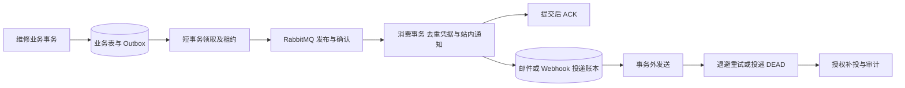

# Atlas CMMS：设备维修增强实现与验证交接

> **最终验收补记（2026-11-14）**：后续实现、完整2,166项回归、性能与故障恢复结果以 [完成报告](maintenance-completion-acceptance.md) 和 [验收清单](maintenance-acceptance-checklist.md) 为准。下文各阶段未实现/待验证记录保留为历史，不作为当前最终状态。

> **前端交付补记（2026-11-14）**：设备工单概览、维修台账和通知失败补投页面已实现并完成独立环境联调。具体入口、验证和本轮修复见本文件第 7 节；下文上阶段“尚无独立管理页面”的记录保留为历史状态。

更新时间：2026-11-14。开发目录：`E:\intern projects\cmms-fork`；分支：`feat/maintenance-reliability`。本文件记录“所有代码”授权后的实现，接续[原始审计](java-backend-enhancement-audit.md)和[技术规划 V2](java-campus-stack-enhancement-plan.md)，不改写历史证据。

## 1. 已交付什么

已实现本轮必做主线与推荐的只读查询模块：**仪表异常周期 → 周期内去重的自动工单 → 备件事务 → Outbox / RabbitMQ 通知 → Redis 设备概览 / MyBatis-Plus 维修台账**。Java 17、Spring Boot 3、JPA、PostgreSQL、原有设备/工单/定期保养业务保留。

这是一组待学习、审阅和继续验证的开发分支改动，不是“全产品问题已修完”或生产上线认证。新增查询、故障查看及补投目前是后端 API，没有新增独立管理页面。Web / 移动端选定维护命令写请求已接入幂等请求头与认证重试修复。

| 模块 | 本轮实现 | 可复核入口 |
|---|---|---|
| 仪表异常与工单 | 显式 PER_EPISODE / ONCE 策略，正常/异常/恢复/再次异常状态；同周期去重、命令重试、事务回滚 | [ReadingService](../api/src/main/java/com/grash/service/ReadingService.java#L60)、[MeterTriggerCommandService](../api/src/main/java/com/grash/service/MeterTriggerCommandService.java#L41) |
| 备件一致性 | 领用、退料、补库、采购审批进入事务命令；父对象及零件锁、非负库存、追加流水、幂等响应 | [InventoryCommandService](../api/src/main/java/com/grash/service/InventoryCommandService.java#L33) |
| 并发编号 | 企业级事务 advisory lock、初始化同步及已有实体刷新，避免不同仪表并发拿到重复工单编号 | [CustomSequenceService](../api/src/main/java/com/grash/service/CustomSequenceService.java#L32) |
| Redis 实战 | 设备工单概览、权限先于缓存、数据库 epoch 驱动版本键、TTL 抖动、Lua 安全解锁、并发回源保护与降级 | [AssetOverviewCache](../api/src/main/java/com/grash/cache/AssetOverviewCache.java#L38)、[概览服务](../api/src/main/java/com/grash/service/query/AssetWorkOrderOverviewService.java#L21) |
| RabbitMQ 实战 | 同事务 Outbox，发布确认和退回，持久队列，提交后 ACK，消费幂等，持久重试、死信、租约恢复、管理员补投 | [OutboxPublisher](../api/src/main/java/com/grash/event/OutboxPublisher.java#L26)、[消费事务](../api/src/main/java/com/grash/event/NotificationCommandService.java#L28) |
| MyBatis-Plus | 新只读维修台账，设备/状态/优先级/仪表来源筛选，安全分页、显式枚举及时间映射；保留 JPA 对照实现 | [查询控制器](../api/src/main/java/com/grash/controller/query/MaintenanceQueryController.java#L20)、[MaintenanceLedgerService](../api/src/main/java/com/grash/service/query/MaintenanceLedgerService.java#L19) |
| 权限与会话局部修复 | 新查询与选定写入口从数据库重新核查用户/角色；Refresh Token 轮换锁及撤销事务修复 | [FreshMaintenanceActor](../api/src/main/java/com/grash/security/FreshMaintenanceActor.java#L23)、[QueryAccessPolicy](../api/src/main/java/com/grash/security/QueryAccessPolicy.java#L30)、[RefreshTokenService](../api/src/main/java/com/grash/service/RefreshTokenService.java#L57) |
| 工程化 | 选定回归、真实依赖集成测试、独立运行 profile、Compose、CI 定义、SQL 对照脚本、客户端重试测试 | [测试脚本](../scripts/test-maintenance.ps1)、[CI](../.github/workflows/maintenance-tests.yml)、[隔离 Compose](../compose.enhancement-test.yml) |

详细协议与限制分别见：[领域与库存](maintenance-domain-reliability.md)、[查询 API](maintenance-query-api.md)、[可靠消息](reliable-events-implementation.md)。以上行号对应本轮最终代码；原审计 S/E 索引继续指向历史基线，不能把修改后的行号当作原始证据。

## 2. 三个必须理解的业务闭环

### 2.1 异常周期和备件命令

仪表写入先加载当前账号并校验输入及订阅，锁定并刷新仪表后检查资源企业与权限，再在同一数据库事务保存读数、推进规则状态、创建工单并写入事件。持续异常不会无条件重复建单；恢复正常后可以开启下一周期。`waitBefore` 以秒记录，零值可在首次异常读数立即开单；正数等待**需要后续被接纳的新异常读数推动**，并非独立时钟到点就创建工单。原 `updateFrequency` 仍按天限制，实际触发可能晚于等待秒数。历史读数编辑/删除不回放状态，旧读数不自动回填；旧数据首次如何识别仍需上线前抽样核对。

备件写操作先加载当前用户并校验输入，锁定并刷新父业务对象后检查资源公司及权限，再按 ID 排序锁定零件，最后更新明细、库存和流水。保留原 Part 乐观锁；额外数据库锁保护多步骤命令。批量替换会刷新锁后明细，避免 JPA 一级缓存里的旧数量导致错误返料。采购审批不能重复入库；批准后的采购明细不可继续修改。

`Idempotency-Key` 以企业、namespace 和 key 为范围；多个库存路由共用 `INVENTORY`。载荷与操作者匹配且当前目标权限仍有效才重放原响应，冲突返回 409。老客户端不传 key 仍可调用，但不具备网络结果不明时的命令重放保证。Web / 移动端现在会在网络错误/5xx 后保留同一次操作的 key；内存映射不跨刷新、重启或不同设备持久化。数据库里命令的未来清理策略必须与重试窗口一起设计，不能随意删表。

### 2.2 工单事件可靠通知



工单创建、分派、状态改变、修改 Webhook 和仪表异常事件已接入。启用可靠事件时，覆盖的旧发送分支和新发送分支互斥，避免同时双发。生产确认只有 ACK 且无 returned message 才判为发布成功；确认与 ACK 都不能代替业务数据库事务。

消费者将去重记录、站内通知和后续投递任务放在同一事务，提交成功后 ACK。外部邮件/Webhook 在事务外发送，失败可重试，工作进程过期租约可被重新接管。失败查看/补投有权限校验和原因审计；新旧 attempt 有独立标识，旧消息不能绕过退避。

外部发送前按通道复查：邮件/PUSH 核对接收资格及相关订阅，Webhook 额外核对端点和 `WEBHOOK` 许可证。**SMTP 接受成功后进程崩溃、数据库尚未记录成功，仍可能导致重发；不声称邮件 exactly-once。** Webhook 接收端应按 `X-Webhook-Id`（稳定 `deliveryId`）去重；`eventId` 用于关联业务事件。外部投递失败达到上限记录为 `event_delivery.DEAD`；消费处理失败达到上限才产生 RabbitMQ 死信发布意图，两者分别使用外投补投与事件重放接口。单机 RabbitMQ 的 quorum 队列不等于已经验证了跨机器高可用。

工单删除、报表邮件、低库存通知尚未整体迁入新账本；库存 afterCommit 通知仍是尽力投递。独立测试配置禁用真实外部投递，不代表真实邮箱已验收。

### 2.3 设备维修查询及缓存

每次查询先重新核查当前账号、订阅、企业关系、功能许可及数据权限，随后读取 PostgreSQL epoch，再查 Redis。缓存保存不可变 DTO，不缓存持久化 User 实体或绕过权限。工单的插入、更新、删除和批量清空由数据库触发器推进 epoch；设备跨企业变化也会推进版本。业务修改与版本变化同事务，读到旧版本的晚到回填不会覆盖新版本键。

这并非“Redis 代替数据库”：每个请求仍有必要的授权与版本查询；Redis 故障使用有并发上限的数据库回源。Redis 是否比直接 SQL 快、是否值得保留两级缓存，需要后续端到端测量。已有 Caffeine 的其他用途未被全量替换，也没有宣称旧统计 Issue #318 的全部口径与缓存都已修复。

新指标是按创建日期筛选的工单 cohort：当前完成数、完成比例、有效完成样本的 `completed_on-created_at` 平均时长。它不是设备 MTTR，也不会把负时长或缺失时间算进平均值。台账数据和 count 在只读 REPEATABLE_READ 事务中取得，同时间再按 ID 稳定排序。

## 3. 实际验证结果

| 检查 | 本轮结果 | 边界 |
|---|---|---|
| 后端选定组合回归 | **585 testcase，0 失败、0 错误、0 跳过** | 包含原有选定回归与新增测试；不是全仓库所有测试 |
| 其中真实依赖测试 | **48 项**：Hibernate 全上下文 11、领域 PG 11、Refresh Token PG 6、PG/Redis/MyBatis 查询 10、PG/RabbitMQ 10 | 后四类部分使用 JDBC 支持的 repository double；不能全称为 Hibernate 全栈测试 |
| 客户端针对性测试 | **9 项通过** | 检查 Web / 移动端 key 生命周期和刷新认证头；没有跑完整前端构建和浏览器 E2E |
| 后端打包 | `mvn package -DskipTests` 成功 | 测试单独执行；这次 package 本身跳过测试 |
| 独立应用启动 | 端口 **28089**；真实数据库和 RabbitMQ 连接；Liquibase 全量历史已应用 | 只连接新测试数据库；健康接口仍受认证保护，匿名请求 401 不等同 Actuator 报告 UP |
| k6 脚本 | JavaScript 语法检查通过 | 未执行正式 HTTP 压测，不填 QPS、p95/p99 或错误率结果 |
| Docker / CI / Testcontainers | 配置或依赖已准备 | 当前机器无 Docker，未运行 Compose、Testcontainers 容器或远端 CI；实际集成测试使用隔离的原生服务 |
| MySQL 独立实验 | Compose、维修表及两会话实验脚本已提供 | 未实际启动 MySQL，CMMS 主库仍为 PostgreSQL |

机器可核查摘要与文件指纹：[maintenance-verification.json](audit-evidence/maintenance-verification.json)。组合测试控制台及 XML 中实际 `<testcase>` 都是 585；部分嵌套测试有同名方法，Surefire 的 `<testsuite tests>` 属性相加只得到 535，不能用该属性误报少跑 50 个测试。

本轮没有以纯 Mock 代替全部事务验证。例如真实 Hibernate 双线程实验曾复现：两个不同仪表预期两个不同工单编号，实际只有一个；对 `CustomSequenceService` 加事务锁并刷新已加载实体后回归通过。库存故障发生在 flush 后，验证外层事务仍可撤销库存、明细、流水、命令记录等变化。消息测试覆盖真实 broker 路由/确认、重复消费、过期租约、重试和本地 HTTP 投递，不访问用户真实邮箱或公网 Webhook。

实测环境：Windows、i5-11400H（6 核 12 线程）、约 16 GB 内存，Java 17.0.8、Maven 3.9.4、Spring Boot 3.5.16、Hibernate 6.6.53.Final、MyBatis-Plus 3.5.18、PostgreSQL 16.16、原生 Redis Windows fork 8.8.0、RabbitMQ 4.4.0 / Erlang OTP 27。Compose 指定 Redis 8.4.0 Linux 镜像，**该镜像组合尚未在本机执行**。

### 3.1 SQL 优化证据

脚本 [query_plan_benchmark.py](../perf/query_plan_benchmark.py) 在新测试数据库的随机临时 schema 生成 **100,000 条合成工单**，十个企业、一千个设备，比较相同统计 SQL：一次预热、三次计时。

| 索引方案 | 执行时间中位数 | 结果 |
|---|---:|---|
| 企业单列索引 | 4.171 ms | 与增强方案结果一致 |
| 企业、设备、创建时间、ID 组合索引 | 0.488 ms | 减少该筛选的扫描工作 |

完整三次执行计划、buffers 及结果在 [query-plan-benchmark.json](audit-evidence/query-plan-benchmark.json)。这是共享开发机、热缓存、均匀合成数据的 **SQL-only 对照**，不是生产性能、Redis 收益或整体 API 提升。没有用这组三次结果宣称高并发能力；还应测真实分布、更新开销和整体请求延迟。

## 4. 如何运行和复现

### 4.1 隔离边界

| 对象 | 地址/目录 | 本轮处理 |
|---|---|---|
| 原部署 | `E:\intern projects\cmms`，前端 3089 / API 18089 / PG 15432 | 未替换业务文件、配置或数据库；最后只读 HTTP 探测可响应 |
| 新开发目录 | `E:\intern projects\cmms-fork` | 本次实现和证据所在；未推送这些实现 |
| 新测试服务 | PG 25432、Redis 26379、RabbitMQ 25672 | 仅环回地址，新数据目录；原生进程实际运行 |
| 新测试 API | `http://127.0.0.1:28089` | `maintenance-lab` profile，外部投递关闭、Quartz 自动启动关闭 |

测试库名 `cmms_enhancement_test`，测试账号为专用公开样例凭据。运行脚本创建的随机 JWT key 放在已忽略的 `local-runtime/maintenance-lab-28089/jwt.key`，不会加入 Git。不要把这些测试账号或 profile 用于公网部署。

### 4.2 推荐复现顺序

有 Docker 时，可先审阅并使用隔离 Compose（本机尚未验证）：

```powershell
docker compose -f compose.enhancement-test.yml up -d --wait
```

在仓库根目录，保证 Java 17 和 Maven 可用，先关闭正在使用同一测试库的实验 API，再运行选定测试：

```powershell
# 仅当该脚本曾启动过 28089 时执行；未启动则无需停止
.\scripts\stop-maintenance-lab.ps1
.\scripts\test-maintenance.ps1
```

默认测试脚本采用 Compose 中的 RabbitMQ 测试账号。本机原生 RabbitMQ 使用 `guest` / `guest` 且仅允许本地，需要传入：

```powershell
.\scripts\test-maintenance.ps1 -RabbitUser guest -RabbitPassword guest
```

`-Maven` 和 `-Settings` 可指定本机工具及 Maven 配置。测试会建立/修改**专用测试库**内的合成数据；不要将测试连接改指原来的 `atlas` 数据库。不要让两个测试进程或实验 API 与测试同时使用这套数据库。

打包并启动新 API：

```powershell
Push-Location api
mvn -B package -DskipTests
Pop-Location
.\scripts\start-maintenance-lab.ps1 -RabbitUser guest -RabbitPassword guest
```

使用 Docker 默认账号时不传 Rabbit 参数；Java 不在 PATH 时传 `-Java '本机 java.exe 绝对路径'`。日志和 PID 存在 `local-runtime/maintenance-lab-28089`；停止脚本核对 jar 路径、profile 与端口才停止进程，不删除数据库。需要比较无缓存 API 时，可单独启动 `-Port 28090 -NoQueryCache`，但正式两实例负载实验仍待执行。

新查询用 POST JSON，详见[请求示例与权限要求](maintenance-query-api.md)。故障补投 API 见[可靠消息说明](reliable-events-implementation.md)。沿用原 JWT、角色、订阅与商业许可；没有为演示查询绕过付费功能检查。测试账号及数据库夹具只是自动化验证数据，不等于已经配置好一套可直接演示的完整前端账号。

客户端测试：

```powershell
# frontend 已有依赖时可直接解析；否则显式指定现有 TypeScript 模块目录
$env:TYPESCRIPT_MODULE = '本机 TypeScript 模块目录'
node scripts/test-maintenance-client.cjs
```

SQL 脚本使用 psycopg（需在实验 Python 环境中安装），只允许指定本地测试库。k6 脚本使用环境变量提供授权令牌及真实测试 fixture ID，不能把令牌提交到 Git。MySQL 实验独立见 [labs/mysql-maintenance](../labs/mysql-maintenance/README.md)。

### 4.3 正式迁移前的注意点

新 Liquibase 变更包括领域幂等/状态表、消息账本、通知去重字段、设备汇总 epoch 触发器及查询索引。即使新查询和消息开关默认关闭，数据库迁移仍会随新版程序执行；**原部署本轮没有升级，因此未执行这些迁移。**

索引当前是普通事务内 CREATE INDEX，数据量大时可能阻塞写入。正式升级前须备份、在副本演练迁移和回滚策略、核对旧规则与时区数据，再决定维护窗口或单独在线建索引方案。不要直接在有本轮新数据后删表回退。库存/仪表正确性修复不由中间件功能开关控制；Redis 查询及可靠事件则默认关闭，在隔离 profile 中显式开启。

## 5. 已有能力、这次新增和未做内容

| 分类 | 内容 |
|---|---|
| 原作者已有 | 设备/工单/预防保养/备件领域模型，Spring Security/JWT，JPA，PostgreSQL，Liquibase，Quartz，Caffeine，邮件/Webhook，原有测试与前端 |
| 本次 Codex 辅助实现 | 异常周期和命令去重、库存事务闭环、并发序列修复、选定入口新鲜权限、Refresh Token 事务修复、Redis 设备概览、MyBatis-Plus 台账、Outbox/RabbitMQ 投递链路、故障恢复、测试与证据脚本 |
| 提供但未执行 | Docker Compose、远端 CI、MySQL 学习实验、k6 正式压测 |
| 尚未实现 | 新概览/故障管理页面，SLA 超时升级，全部设备会话 UI 与 access JWT 即时撤销，报修合并 #353，旧统计全量改造，所有 Quartz 多实例一致性，全部旧通知迁移 |
| 本轮不引入 | 微服务、Nacos/Sentinel、分库分表、秒杀、商城、短链接、全库换 MySQL、Elasticsearch、Redisson 通用锁 |

新增计数器和投递状态可用于观察，但没有部署 Prometheus/Grafana，也没有证明现有所有安全风险都被消除。现有许可证、商业功能 gate 与作者归属保留。 启动仍有原有历史 Liquibase 文件名前导空格引起的 URI 警告、Quartz final 方法代理和 open-in-view 提示；本轮完整迁移校验及启动成功，但没有借此宣称这些历史警告已清理。

## 6. 如何把这组改动变成自己的能力

**通用技术亮点**：Spring 事务传播、JPA 一级缓存与数据库锁、业务幂等、Redis Cache Aside/版本键/Lua、RabbitMQ confirm/ACK/重试/死信、Outbox 一致性、显式 SQL 与分页、真实依赖回归。

**设备维修特色**：异常周期和恢复语义；自动维修工单与编号一致性；领用/退料/采购补库；派单后的可追踪通知；有明确统计口径的设备维修台账。

本轮是 Codex 辅助实现，不能直接写成“全部由我独立原创”，不能把原作者能力或 585 项历史与新增混合测试全当作自己新增。学完、能解释并独立完成后续修改后，可如实表达“基于 Atlas CMMS 二次开发，设计并验证……”，保留 AGPL 与商业许可约束。

建议学习顺序：

1. 阅读 `InventoryCommandService → PartService → DomainCommandStore`，独立画出一次领用和回滚过程，运行对应测试。
2. 阅读 `ReadingService → MeterEpisodeRules → MeterTriggerCommandService`，自己增加一个恢复后再次异常的测试，并解释历史编辑为什么不重放。
3. 阅读 `AssetOverviewCache` 与 epoch SQL，自己复现“更新后旧读回填”和权限撤销；解释为什么 TTL 本身不够。
4. 阅读 `ReliableEventService → EventStore → OutboxPublisher → WorkOrderEventListener → NotificationCommandService`，逐一标出提交与 ACK 边界。
5. 自己更改一次台账筛选或新增一个维修指标，先写手算夹具，再跑 JPA 对照和 EXPLAIN；最后才开展正式 k6 对比。

面试至少能讲清：锁后为什么还需 refresh；为什么幂等 key 不能只查一次再插入；Redis 命中为什么仍要授权；RabbitMQ ACK 为什么不等于业务完成；为什么邮件不能保证绝对一次；工单周期为什么不是 MTTR。Codex 可以辅助生成夹具、查 API 和审阅改动，领域不变量、失败窗口、测试判断和证据解读应由你掌握。


## 7. 三个前端页面及真实接口联调（2026-11-14）

本轮继续在 `cmms-fork` 的开发分支完成前端，保留原产品的 React 17 / MUI 5 结构和作者标识，没有替换原来的前端部署。

| 页面 | 独立实验站点路径 | 已接功能 |
|---|---|---|
| 设备工单概览 | `/app/maintenance/overview`，支持 `?assetId=152` | 按可见设备名称检索；UTC 起止区间、归档/演示筛选；总数、完成数/率、有效工单周期及异常样本说明 |
| 维修台账 | `/app/maintenance/ledger` | 设备、状态、优先级、仪表来源筛选，服务端分页/排序，工单及设备详情跳转 |
| 通知失败补投 | `/app/maintenance/notification-failures` | 区分终止失败事件和外部投递；原因 5–500 字符、确认、提交锁、状态冲突处理、授权刷新；SKIPPED 不可强制补投 |

入口加入侧边栏，设备详情的工单页也可直接进入该设备概览或台账；有下属企业关系的账号也保留新入口，再进行本企业权限判断。中英文文案已合入原 i18n。客户端只做可见性引导，服务端继续检查账号、席位、角色、企业数据范围和原有功能许可，没有绕过商业许可。

**可访问的独立前端：`http://127.0.0.1:3289`**。它的 `/api/` 只代理到独立 API `28089`，不访问原 `18089`；WebSocket 使用同一受限代理。原前端 `3089`、原 API、原 PostgreSQL `15432` 及原部署配置没有被替换。依赖复制到 C 盘独立目录后才连接进 Fork，构建缓存不写回原 `cmms/frontend/node_modules`。

账号只写在已忽略的 `local-runtime/maintenance-frontend/access.txt`，不提交 Git。本轮经正常注册/邀请创建了实验企业 152、管理员 152、只读用户 153、设备 152/153 和 30 条工单。所有这些数据都在 `25432/cmms_enhancement_test`，没有复制私有生产数据，也没有将测试账号或令牌写入源码。另保留一条明确标记为合成故障的 DEAD 事件供手动体验；外部邮件和 Webhook 发送保持关闭。

### 7.1 实测结果

| 验证 | 本轮结果与口径 |
|---|---|
| TypeScript | 全站 `tsc --noEmit --incremental false` 通过；修改前基线也通过 |
| 生产构建 | `react-app-rewired build`，`Compiled successfully`；禁用 Sentry 上传和 source map；不是只运行开发服务器 |
| 客户端回归 | **25 项通过**，涵盖既有命令 key、刷新后认证头、补投 409 提示及新增会话竞态 |
| 查询契约 | **23 项通过**，覆盖 UTC/非法日历/366 天、载荷、路径、权限、企业切换、分页与错误码 |
| 补投客户端契约 | 请求路径、原因边界、AbortSignal、状态错误和局部 409 处理脚本通过 |
| 后端针对性回归 | `ReliableEventsPostgresIntegrationTest` **11 项通过**，真实 PG/RabbitMQ；本轮未重跑上一阶段整个 585 项组合，不能据此宣称当前已跑 586 项全套 |
| 浏览器 | 系统 Chrome / Playwright；Browser 插件不可用。1440×1000 桌面和 390×844 手机视口；页面身份、非空、无框架覆盖层、筛选、分页、空结果、真实补投、普通用户拒绝、设备详情快捷跳转均验证 |
| 故障交互 | 浏览器注入 503 验证错误后旧指标隐藏和恢复；真实并发恢复产生 409，页面仅提交一次且不触发原全局“稍后重试”提示 |
| 数据库验收 | 初次重放的 `consumer_receipt=1`、`notification=1`；该事件和外投补投审计各 1；邮件为 `SKIPPED / MAIL_DISABLED`，`sent_at=null` |

页面显示的真实样例：设备 152 的 20 张工单中 5 张完成，完成率 25%；整个台账 30 条，第一页 25 条、第二页 5 条；其中 COMPLETE 共 7 条。测试未把组件模拟数据当作真实后端成功，也未把“恢复已安排”显示为“已送达”。

浏览器没有新增 `pageerror`。环境阻止原有 Google Fonts 外链访问，使用系统后备字体；原 STOMP 初始化仍会提示缺少自动重连 factory。这两项已记录，没有声称原产品的所有控制台提示被清除。503/409 故障测试的预期 HTTP 报错与正常流程分开记录。手机表格在容器内横向滚动，页面本身没有水平溢出。

本机完整证据在 `C:\Users\roxanne\Documents\Codex\work\cmms-frontend-enhancement`：`browser-qa.json`（12 组初始流程）、`browser-qa-readonly.json`（最终只读回归）、`browser-extra-qa.json`（真实登录、并发 409、设备导航）、`asset-pending-after.json`（设备输入回归）、`db-after-browser.json`、最终构建日志及截图。这些文件和凭据均未添加到公开仓库。`frontend-verification-summary.json` 汇总当前代码/构建指纹，不能用上阶段的指纹冒充本轮版本。

### 7.2 联调发现后修复的三个问题

1. **已恢复事件仍出现在失败列表**：后端原查询会展示旧代数 DEAD 记录。`EventReplayService.failures()` 现仅列同企业/事件/处理器最新尝试仍 DEAD、且没有成功消费凭据的记录；新的真实数据库回归证明重放中和成功后旧记录不再出现。
2. **切账号时自动重放旧请求**：Web `api.ts` 为请求及刷新绑定会话快照。旧账号的迟到刷新不得覆盖或清除新账号 token；旧请求不得以新账号重试。同会话并行 401 继续共享刷新，晚到 401 复用已更新 token，维护命令 key 保持稳定。没有据此宣称移动端所有会话竞态已重构。
3. **输入未确认设备名称仍查询旧设备**：真实浏览器复现“设备 A → 输入无匹配名称 → Escape → Enter”。现进入待确认搜索状态，隐藏旧指标/台账并禁止提交；提供显式清空按钮，选择结果后恢复查询，台账清空后可明确查询所有设备。

### 7.3 代码与启停

- 查询页与共用组件：`frontend/src/content/own/MaintenanceQueries/`；客户端契约：`frontend/src/utils/maintenanceQueries.ts`。
- 通知页：`frontend/src/content/own/NotificationFailures/`；客户端契约：`frontend/src/utils/notificationFailures.ts`。
- 菜单权限引导：`frontend/src/utils/maintenanceAccess.ts`；路由：`frontend/src/router/app.tsx`。
- 稳定会话与局部冲突提示：`frontend/src/utils/api.ts`；回归：`scripts/test-maintenance-client.cjs`。
- 后端失败列表：`api/src/main/java/com/grash/event/EventReplayService.java`；新增数据库回归位于 `ReliableEventsPostgresIntegrationTest`。

已有构建和独立 API 就绪时，可在 Fork 根目录使用：

```powershell
.\scripts\start-maintenance-frontend.ps1 -Node '本机 node.exe 绝对路径'
# 需要停止时仅核对并停止此实验前端；不影响原前端/数据库
.\scripts\stop-maintenance-frontend.ps1
```

前台运行方式为 `node scripts/serve-maintenance-frontend.cjs`。固定环回端口 3289 / 后端 28089 是实验隔离边界，不能将这个代理脚本当成生产网关。

本轮仍未提交或推送。新增页面及修复是 Codex 辅助实现，后续学习应能独立解释筛选与已应用结果的区别、取消请求与服务端事务的区别、刷新 token 的并发边界，以及为何重放成功不等于邮件送达。
